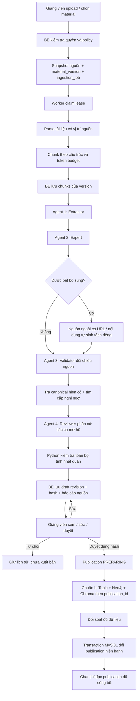

# Kế hoạch triển khai ingestion tri thức cho Socratic AI

Ngày: 2026-11-02. Trạng thái: **người dùng đã duyệt triển khai theo gói**. Đã viết nền tảng tiền xử lý/runner cục bộ; workflow BE/bốn agent/review/publish và reader theo publication chưa hoàn tất. Hướng dẫn hiện hành: `ingestion-local-guide.md`.

Tài liệu này mô tả thiết kế đích; phần chưa được report xác nhận vẫn là mục tiêu. Bốn migration ingestion đã được viết trong BE không có nghĩa các API, worker, publisher hoặc bộ đọc bên dưới đã hoạt động. Không chạy ứng dụng, DB, migration, test, seed hay LLM trong các đợt hiện tại.

**Phạm vi cập nhật 2026-11-03.** Đợt này chỉ xử lý văn bản có sẵn trong tài liệu. OCR được hoãn khỏi các gói triển khai hiện hành. TXT, Markdown, code và phần văn bản đọc được từ PDF, DOCX, PPTX vẫn thuộc phạm vi.

## 1. Mục tiêu và các quyết định đã chốt

Ingestion phải biến học liệu thành tri thức có thể kiểm chứng, được giảng viên duyệt và dùng được trực tiếp trong hội thoại Socratic. Chất lượng nằm ở việc giữ đúng nghĩa, điều kiện áp dụng, quan hệ, nguồn và bước giải; số lượng agent không tự bảo đảm độ thông minh.

Các quyết định từ người dùng:

1. Giữ bốn vai trò AI phối hợp; sửa nhiệm vụ và hợp đồng dữ liệu của chúng.
2. Mặc định chỉ trích xuất từ tài liệu. Không thêm kiến thức ngoài hoặc tự bịa phần tài liệu còn thiếu.
3. Khi giảng viên bật bổ sung, nguồn bên ngoài phải có URL/trích dẫn. Nội dung AI tự sinh phải có nhãn riêng.
4. Giảng viên/admin có quyền rà soát đồ thị trước khi đưa vào sử dụng.
5. AI tự sinh nhiều Topic theo nội dung; Topic–Chunk là quan hệ nhiều–nhiều. FE chat không truyền Topic.
6. Các giới hạn file, token, model, concurrency và retry được cấu hình qua biến môi trường; xem `ingestion.env.example` cùng thư mục.
7. Dùng bộ CREATE TABLE hiện hành của BE và `material_publications`; không dùng lại đề xuất ALTER/expand cũ trong SQL 004–007 của repo AI.
8. Lượt này chỉ lập kế hoạch và cấu hình mẫu; chưa thay đổi `.env` thật hoặc code chạy.

Các lựa chọn kỹ thuật bên dưới là phương án đề xuất cụ thể để duyệt, chưa phải quyết định đã triển khai.

## 2. Hiện trạng và lý do cần đổi

Đường bốn agent hiện đọc tại `app/service/ingestion/multi_agent.py`:

```text
File → load_file_content → chunker
     → Extractor từng chunk → nhóm cố định 5 kết quả
     → Expert → Validator chuyển thành schema
     → merge theo tên → embeddings → cosine → Reviewer
     → JSON dùng chung đường dẫn → ghi Neo4j trực tiếp
```

Những chỗ phải sửa trước khi có thể coi đây là pipeline sản phẩm:

| Hiện trạng trong code | Hệ quả | Phương án |
|---|---|---|
| Nhiều import `src.*` trong cây `app/` | Entrypoint không nhất quán | Chuẩn hóa riêng các module ingestion được sử dụng |
| API ingestion đang rỗng, chưa nối router | Chưa có vòng đời request/job đầy đủ | API công khai qua BE; AI chạy worker có hợp đồng nội bộ |
| Extractor/Expert trao đổi Markdown, rồi nhờ Validator ép JSON | Khó truy vết và phát hiện mất dữ liệu | DTO JSON có kiểm tra schema ngay từ đầu |
| Validator không thấy đầy đủ nguồn gốc | Không xác minh được fact/hướng quan hệ | Gửi nguồn được tham chiếu và evidence vào Validator |
| Reviewer đọc nhầm prompt Extractor | Đánh giá trùng nghĩa không đúng nhiệm vụ | Prompt riêng và DTO quyết định rõ ràng |
| Gộp tên/cosine tự động | Có thể nhập hai nghĩa khác nhau | Chỉ dùng similarity lấy ứng viên; phân xử có bằng chứng |
| Gộp làm mất definition/example/source | Tri thức suy giảm sau mỗi lần merge | Merge bảo toàn mọi assertion và liên kết nguồn |
| `Entity.id = name`, thiếu canonical/scope | Không khớp bộ đọc Socratic | Chuẩn hóa canonical_code, chủ sở hữu và projection |
| Topic chỉ có một object, chưa ghi Topic–Chunk | Chat không định vị được chủ đề có nguồn | `topics[]`, `topic_chunk_links[]` rõ ràng |
| Ghi graph trực tiếp trước duyệt | Bản nháp có thể đi vào chat | Draft bất biến → duyệt → chuẩn bị → xuất bản |
| Chạy gather không giới hạn; lỗi vẫn báo hoàn tất | Khó vận hành, khó debug | Job/lease/checkpoint, lỗi có mã, stage có trách nhiệm |

`app/ingest.py` là đường LightRAG khác với pipeline này. Đề xuất chọn pipeline bốn agent làm đường ingestion chính; không để hai đường cùng ghi một bộ dữ liệu. Chưa xóa module còn lại trong giai đoạn lập kế hoạch.

## 3. Ranh giới trách nhiệm của hệ thống

| Thành phần | Làm gì | Nguồn trạng thái chính |
|---|---|---|
| FE quản trị học liệu | Upload, chọn chính sách nguồn, xem tiến trình, kiểm tra nguồn, sửa và duyệt draft | Đọc API BE |
| Spring Boot BE | Xác thực/quyền, quản lý material/version/job/chunk/draft/review/publication, transaction MySQL | MySQL |
| AI worker | Parse, chunk, bốn agent, kiểm tra dữ liệu, tạo payload, chuẩn bị projection Neo4j/Chroma theo lệnh publisher | DTO + checkpoint đã được BE xác nhận |
| Object/file storage | File nguồn bất biến, bản parse và artifact theo job | URI + SHA-256 |
| Neo4j | Đồ thị và nội dung sư phạm của từng publication | Projection từ draft đã duyệt |
| Chroma | Chỉ mục vector của chunk/entity theo publication | Projection có thể tái tạo |
| AI chat | Truy hồi nội dung đã xuất bản và được phép truy cập; tự suy Topic | Publication snapshot do BE/MySQL cung cấp |

**Một bên ghi trạng thái nghiệp vụ:** đề xuất BE là nơi duy nhất sửa các bảng ingestion trong MySQL. AI không vừa gọi API BE vừa tự cập nhật status bằng một repository khác. AI gửi kết quả từng stage qua API nội bộ, kèm lease/version để BE kiểm tra.

BE có dependency Kafka nhưng phần khảo sát chưa thấy consumer/producer ingestion đang dùng. Giai đoạn đầu đề xuất lấy job từ MySQL thông qua API claim của BE, dùng lease đã có trong schema; không bắt buộc thêm Kafka/Redis. Nếu sau này dùng Kafka, message chỉ thông báo có việc; MySQL vẫn quyết định quyền thực thi, retry và trạng thái.

Không giữ transaction DB trong khi gọi LLM, tải nguồn ngoài hoặc tạo embeddings.

## 4. Luồng dữ liệu tổng thể



Luồng có hai mốc khác nhau: **draft sẵn sàng để duyệt** và **publication sẵn sàng cho chat**. Không phát thông báo “hoàn tất” ngay sau khi Agent 4 trả kết quả.

## 5. Các kho dữ liệu và nội dung thực tế

### 5.1 MySQL: hồ sơ tài liệu, workflow, nguồn và điểm công bố

Đây là bộ bảng hiện hành đã viết trong migration BE. Phần này giải thích cách dùng, không phải yêu cầu tạo thêm bảng.

| Bảng | Một row đại diện cho | Dữ liệu chính | Thời điểm ghi |
|---|---|---|---|
| `materials` | Một học liệu logic | Tên, file hiển thị, uploader, course/lesson | Upload/đăng ký học liệu |
| `material_versions` | Một bản nguồn + cách parse/chunk bất biến | material_id, version_number, source_hash, snapshot_url, parser/chunker_version, created_by | Chấp nhận một phiên bản mới |
| `ingestion_jobs` | Một lần xử lý với policy/config cố định | version_id, requester, idempotency, status/stage, configuration, checkpoint, lease, lỗi, publication_state | Tạo/claim/cập nhật job |
| `material_chunks` | Một đoạn thuộc chính xác một version | chunk_id, version_id, index, content, scope/owner/subject, token_count, offsets, metadata | Sau chunking, trước Extractor |
| `knowledge_graph_drafts` | Một revision đề xuất tri thức | graph_payload, source_manifest, validation_report, payload_hash, kết quả duyệt | Kết thúc pipeline hoặc sau sửa draft |
| `material_publications` | Lần chọn một draft để công bố của một job | material/version/job/draft, status, is_current, người/thời điểm xuất bản | Bắt đầu publish; cập nhật khi hoàn tất |
| `topics` | Một Topic của một publication | name, summary, concepts_included là canonical_code[] | Chuẩn bị projection từ draft đã duyệt |
| `topic_chunks` | Một liên kết Topic–Chunk | topic_id, chunk_id | Cùng đợt ghi Topic |

Không ghi trạng thái học sinh, mastery hoặc misconceptions của học sinh trong ingestion. Đó là dữ liệu phát sinh từ chat/đánh giá; `common_mistake` trong học liệu chỉ là lỗi thường gặp được trích/sinh và duyệt, chưa phải kết luận về một học sinh.

**Version và job khác nhau:** đổi file hoặc cách parse/chunk làm thay đổi chunk boundaries → version mới. Chạy lại agent/model/prompt trên đúng chunks → job mới trên cùng version. Retry vì lỗi mạng → tiếp tục job hiện tại. Version đã có chunks không được âm thầm chunk lại với cấu hình khác.

`configuration` phải lưu snapshot của cấu hình chunking có hiệu lực hoặc manifest trỏ tới cấu hình đó. Job mới trên version cũ phải kiểm tra khớp snapshot chunking đã dùng. Với version legacy thiếu manifest, không tự suy đoán: cần xác nhận hoặc tạo version mới.

**Các giới hạn của schema cần tuân thủ:**

- Một job chỉ có một row publication (`UNIQUE(job_id)`). Retry publish dùng lại row đó. Sau khi đã chọn draft cho publication, muốn chọn revision khác thì tạo job mới với nguồn/config thích hợp; không chèn publication thứ hai của cùng job.
- `is_current=1` chỉ dành cho `PUBLISHED`; trạng thái khác dùng `NULL`, không dùng `0` cho toàn bộ lịch sử.
- `source_hash`/snapshot hiện cho phép NULL để tương thích seed/legacy. Production publish phải từ chối nguồn chưa xác minh, thay vì bịa hash.
- Quyền giáo viên, hash tính từ payload và bất biến revision được BE kiểm tra; FK không tự bảo đảm các điều này.
- UUID BINARY(16) dùng cùng quy tắc bytes hiện hành. API nhận chuỗi UUID chuẩn; không phụ thuộc `UUID_TO_BIN` trên server của người dùng.

### 5.2 Topic–Chunk nhiều–nhiều và cách tránh lẫn revision

Ví dụ tài liệu có ba chunk:

```text
C1: Khái niệm phụ thuộc hàm, ví dụ A → B
C2: Bao đóng và ví dụ áp dụng phụ thuộc hàm
C3: Khóa ứng viên và kiểm tra tính tối thiểu bằng bao đóng

T1 Phụ thuộc hàm       → C1, C2
T2 Bao đóng thuộc tính → C2, C3
T3 Khóa ứng viên       → C3
```

`concepts_included` của T3 có thể là `["DB.CANDIDATE_KEY", "DB.ATTRIBUTE_CLOSURE"]`. Các code này minh họa quy ước, không khẳng định code đang tồn tại trong DB.

Không gán mọi chunk trong batch cho mọi Topic. Expert phải trả từng link kèm bằng chứng nội dung. Topic tóm tắt từ các chunk được liên kết; bỏ yêu cầu ép tất cả nội dung thành một Topic lớn.

Đề xuất Topic là **projection riêng của publication**, không merge toàn cục chỉ vì trùng tên. Schema topics chưa có publication_id nên danh sách topic_id và links của mỗi publication phải nằm trong graph_payload đã hash; BE/publisher dùng manifest đó để xác định quyền đọc. ID Topic được cấp trước khi duyệt, bất biến trong revision. Khi một revision được đưa sang job khác để xuất bản, tạo revision sao chép với Topic IDs mới rồi duyệt lại; không tái sử dụng Topic row để sửa nội dung đã công bố.

Đặc biệt, nếu hai publication dùng cùng material_version, chỉ lọc Topic qua published chunk chưa đủ vì chunk có thể được dùng chung. Bộ đọc phải kiểm tra topic_id thuộc manifest của publication đã chọn. Khi quy mô tăng, có thể chuẩn hóa thành bảng publication_topics; **chưa yêu cầu thêm bảng này trong giai đoạn đầu**. Chi phí đọc JSON/manifest được giảm bằng snapshot cache theo publication, có giới hạn kích thước và invalidation rõ ràng.

### 5.3 Object/file storage: giữ nguồn bất biến

Các object đề xuất:

```text
materials/{material_id}/versions/{version_id}/source.{ext}
materials/{material_id}/versions/{version_id}/parsed-document.json
ingestion/{job_id}/stages/{stage}/attempt-{n}/result.json
ingestion/{job_id}/external/{source_id}/snapshot.txt
```

Snapshot nguồn gốc cần ổn định dù `materials.file_url` đổi. URL truy cập có chữ ký hết hạn không phải định danh nguồn lâu dài: lưu object key/URI nội bộ, phát URL tạm khi người có quyền xem.

Parsed document chứa blocks, trang/slide/heading, nội dung bảng/code/công thức và cảnh báo parse. Artifact chứa request/response đã lọc dữ liệu nhạy cảm và usage khi cần debug; không lưu chain-of-thought hoặc secret. Không đưa nguyên mọi artifact lớn vào checkpoint JSON.

### 5.4 Neo4j: định danh chung, nội dung theo publication

Giữ các loại miền nghiệp vụ đã có:

- KnowledgeEntity: canonical_code, subject và định danh chuẩn.
- Definition: content, conditions, exceptions.
- Process/ProcessStep: name/description, thứ tự, action, hint_prompt nếu có nguồn/hợp lệ.
- Exercise/ExerciseStep: đề bài, độ khó, instruction, expected_outcome, socratic_question, common_mistake, process_step_id nếu biết.
- Example: title, code_snippet, explanation.
- Argument: hypothesis, evidence, conclusion.
- ConceptRubric/ConceptCriterion: tùy chọn, tiêu chí có phiên bản và nguồn, nếu nội dung đủ điều kiện được duyệt.

**Đề xuất thêm `KnowledgeEntityRevision`** để giữ description/name/aliases và nguồn riêng theo publication mà vẫn giữ canonical_code chung. Đây là bổ sung thiết kế graph, chưa tạo trong Neo4j.

```text
KnowledgeEntity {canonical_code: DB.CANDIDATE_KEY}
  └─ HAS_REVISION → KnowledgeEntityRevision {
       id, canonical_code, publication_id,
       name, description, subject, scope, owner_id, source_ref_ids
     }
       ├─ HAS_DEFINITION → Definition {..., publication_id, source_ref_ids}
       ├─ HAS_EXAMPLE → Example {..., publication_id, source_ref_ids}
       └─ HAS_EXERCISE → Exercise {..., publication_id, source_ref_ids}

KnowledgeEntity -[:REQUIRES {
    id, publication_id, source_ref_ids, scope, owner_id
}]-> KnowledgeEntity
```

Các node/edge có nội dung nguồn đều phải gắn publication_id và phạm vi. Nội dung kiểu mảng JSON lồng nhau không ghi thẳng thành property Neo4j: mapper chuyển thành node/edge hoặc chuỗi JSON có contract; source_ref_ids là danh sách chuỗi, nguồn đầy đủ nằm trong manifest.

KnowledgeEntity toàn cục chỉ là registry định danh, không đủ làm bằng chứng được phép đọc. Canonical identity mới được BE giữ chỗ trong draft/registry ở bước resolution; projection MERGE theo canonical_code và kiểm tra collision. Registry không được trả description chưa duyệt hay tiết lộ tên học liệu riêng. Nếu metadata định danh của một khái niệm chỉ có ở tài liệu riêng, truy vấn chỉ được trả nó khi có revision hiện hành được phép xem.

Bộ đọc chat hiện đọc trực tiếp `KnowledgeEntity.description` và satellites theo scope. Vì vậy phải sửa adapter thành đọc revision/edges theo publication snapshot; không chỉ thêm node rồi giữ query cũ. Không sửa global description khi đang chuẩn bị bản mới.

Quan hệ học thuật phải phân biệt `REQUIRES`, `PART_OF`, `IS_A`, `CONTRASTS_WITH`... REQUIRES không suy ra chỉ vì hai khái niệm xuất hiện cùng đoạn. Quan hệ mơ hồ giữ issue để giáo viên quyết định.

### 5.5 Chroma: chỉ mục theo publication, đúng embedding identity

Hai projection: chunk retrieval và entity lookup. Có thể dùng hai collection riêng như chat hiện tại, nhưng mỗi collection chỉ chứa một embedding identity và metric cosine đã xác minh.

Ví dụ chunk record:

```json
{
  "id": "{publication_id}:{chunk_id}",
  "document": "Nội dung chunk nguyên bản dùng để truy hồi",
  "metadata": {
    "chunk_id": "uuid-chunk",
    "publication_id": "uuid-publication",
    "material_id": "uuid-material",
    "document_id": "uuid-material",
    "material_version_id": "uuid-version",
    "owner_id": "uuid-owner",
    "scope": "TEACHER",
    "subject": "CS-201",
    "chunk_index": 2,
    "canonical_codes_csv": "DB.ATTRIBUTE_CLOSURE,DB.CANDIDATE_KEY",
    "embedding_identity": "openai:text-embedding-3-small:1536"
  }
}
```

Ví dụ entity record: id=`publication_id:canonical_code`, document là mô tả đã duyệt của revision; metadata có canonical_code, name, publication_id, owner/scope/subject và embedding_identity. Metadata chỉ dùng kiểu scalar được adapter hỗ trợ; không nhét mảng/nested JSON tùy ý.

Không dùng chunk_id hoặc canonical_code đơn lẻ làm ID projection khi cùng version/concept có thể có nhiều publication: sẽ ghi đè metadata của bản cũ lúc chuẩn bị bản mới. Cần sửa vector adapter để lấy `chunk_id` từ metadata, không coi record ID ghép là UUID MySQL.

Embedding identity lấy từ cấu hình provider/model/dimension thực tế; không chỉ đổi chuỗi metadata để hợp thức hóa vector cũ. Đổi identity → collection mới có tên riêng → backfill có chủ đích → kiểm tra → đổi cấu hình. Không tự xóa collection đang dùng.

## 6. Contract dữ liệu chung

### 6.1 Quy ước

- Public API Spring Boot đề xuất camelCase; API nội bộ AI dùng snake_case. Mapping tập trung tại adapter, không truyền hai tên cho cùng một field.
- UUID chuỗi chuẩn ở HTTP/JSON, BINARY(16) trong MySQL; timestamps UTC dạng ISO-8601, FE chuyển múi giờ hiển thị.
- BE cấp job/version/publication/revision IDs. Worker cấp local fact/entity IDs qua code, không để LLM tự bịa UUID nghiệp vụ.
- Chuỗi `canonical_code` có namespace môn/nghĩa; mã mới phải được resolution kiểm tra collision. Tên hiển thị không phải khóa.
- Mỗi payload có schema_version. Field bắt buộc thiếu là lỗi validation; field chuyên môn không có nguồn là null/[] với missing_fields, không tự điền cho đủ form.
- Hash dùng SHA-256 trên serialization JSON chuẩn hóa được đặc tả chung: UTF-8, thứ tự key ổn định, quy tắc number/null/array rõ ràng. BE tính lại hash, không tin hash worker gửi. Bộ fixture hash phải cho Java/Python cùng kết quả khi người dùng chạy kiểm tra sau này.

### 6.2 DTO public BE đề xuất

Các đường dẫn sau là **API mới được đề xuất**, cần ghép với controller upload/quyền của BE lúc triển khai; chưa khẳng định tồn tại.

| DTO | Fields chính | Quy tắc |
|---|---|---|
| CreateIngestionRequest | materialId, sourceVersionId?, subject, sourcePolicy, allowAiGenerated, configurationOverrides?, idempotencyKey | teacher từ principal; không nhận role/user_id tự khai để cấp quyền |
| IngestionJobResponse | jobId, materialId, versionId, status, currentStage, completedUnits, totalUnits?, warnings, error?, latestDraftId?, createdAt | Không biến số stage thành % độ chính xác |
| DraftDetailResponse | draftId, revisionNumber, payloadHash, reviewStatus, graphPayload, validationReport, sourceManifest | Chỉ người có quyền material được xem |
| CreateDraftRevisionRequest | baseDraftId, expectedPayloadHash, operations[], comment? | Dùng JSON Patch có allowlist; tạo revision mới, không sửa bản cũ |
| ReviewDraftRequest | expectedPayloadHash, decision, comment? | decision APPROVED/REJECTED/CHANGES_REQUESTED; từ chối hash cũ |
| PublishDraftRequest | draftId, expectedPayloadHash, idempotencyKey | Draft APPROVED, thuộc job, chưa đổi nguồn/config |
| RetryJobRequest | expectedStatus, reason? | Không sửa source policy/model giữa retry |
| JobError | code, stage, retryable, message, correlationId, issueIds[] | Không trả stacktrace/secret ra FE |

Ví dụ request:

```json
{
  "materialId": "uuid-material",
  "subject": "CS-201",
  "sourcePolicy": "DOCUMENT_ONLY",
  "allowAiGenerated": false,
  "configurationOverrides": {"language": "vi"},
  "idempotencyKey": "teacher-generated-request-key"
}
```

`sourcePolicy=EXTERNAL_ALLOWED` cho phép truy hồi nguồn có URL. `allowAiGenerated=true` là opt-in riêng để thêm ví dụ/câu hỏi/tiêu chí tự sinh; BE chỉ cho phép khi sourcePolicy cho phép bổ sung và actor có quyền. Không mặc định bật hai option vì một option đã bật. ConfigurationOverrides chỉ cho phép allowlist, có trần hệ thống; không cho FE chọn API key, host nội bộ, file path hoặc bỏ kiểm tra nguồn.

Endpoint đề xuất:

```text
POST /api/v1/materials/{id}/ingestion-jobs         → 202 + job
GET  /api/v1/ingestion-jobs/{jobId}                → snapshot trạng thái
GET  /api/v1/ingestion-jobs/{jobId}/events         → SSE trạng thái
POST /api/v1/ingestion-jobs/{jobId}/cancel
POST /api/v1/ingestion-jobs/{jobId}/retry
GET  /api/v1/ingestion-jobs/{jobId}/drafts
GET  /api/v1/knowledge-graph-drafts/{draftId}
POST /api/v1/knowledge-graph-drafts/{draftId}/revisions
POST /api/v1/knowledge-graph-drafts/{draftId}/review
POST /api/v1/ingestion-jobs/{jobId}/publish
```

Path materialId là nguồn chính; nếu giữ materialId trong body thì phải khớp. Cùng idempotencyKey/requester và cùng request fingerprint → trả job cũ; cùng key khác request → 409. Review không đúng quyền → 403; hash/state đã đổi → 409; file vượt giới hạn → 413; DTO/policy sai → 422 theo error contract BE.

### 6.3 DTO nội bộ BE ↔ AI

| DTO | Nội dung |
|---|---|
| ClaimedJob | job_id, version_id, lease_token, lease_expires_at, pipeline_version, configuration_snapshot, source_policy, allow_ai_generated, trusted access_scope, source descriptor, checkpoint |
| SourceDescriptor | material_id, source_object_key, source_hash, mime_type, size_bytes, subject; URL truy cập ngắn hạn nếu cần |
| ParsedDocument | schema_version, source_hash, parser_version, blocks[], parse_warnings[], quality_summary |
| DocumentBlock | block_id, kind TEXT/TABLE/CODE/FORMULA/IMAGE, text, page_or_slide?, heading_path[], source_locator, parse_confidence? |
| ChunkProposal | chunk_id, chunk_index, content, token_count, content_hash, block_refs[], char_start?, char_end?, extra_metadata |
| ChunkBatchCommit | job_id, lease_token, batch_key, proposals[], batch_hash |
| StageCheckpoint | job_id, lease_token, stage, completed_unit_ids, artifact_uri, artifact_hash, usage_summary, error? |
| DraftSubmission | job_id, lease_token, graph_payload, source_manifest, validation_report, payload_schema_version |
| PreparePublicationTask | publication_id, draft_id, approved_payload_hash, publication_generation, graph_payload/URI, trusted scope, required_projections |
| ProjectionReceipt | publication_id, store, manifest_hash, expected_counts, actual_counts, verified_ids_hash, embedding_identity?, lease_token |

API claim/heartbeat/checkpoint/chunks/draft/prepare-result chỉ gọi bằng service identity; không public qua FE. Token service không cho tự đổi scope/quyền. Mọi mutation theo job kiểm tra lease còn hạn và khớp token trong transaction; request của worker cũ bị từ chối.

Trong bước publisher, mỗi công việc phải được điều phối theo generation/lease. BE cấp publication task từ nội dung đã duyệt; receipt chỉ được công nhận nếu generation và manifest hash khớp. Projection bất biến và ghi idempotent, nên một worker cũ không được ghi nội dung khác cùng ID.

### 6.4 DTO facts, nguồn và kết quả bốn agent

```json
{
  "fact_id": "fact-local-17",
  "kind": "DEFINITION",
  "text": "Khóa ứng viên là siêu khóa tối thiểu theo quan hệ bao hàm.",
  "entity_local_ids": ["entity-local-3"],
  "origin": "DOCUMENT_EXTRACTED",
  "source_ref_ids": ["source-ref-12"],
  "conditions": [],
  "exceptions": [],
  "missing_fields": []
}
```

SourceRef có `source_ref_id, origin, source_id, chunk_id?, block_id?, start?, end?, quote, locator, url?, title?, accessed_at?, snapshot_hash?`. start/end là offset Unicode code point trên `block.text` bất biến, end không bao gồm ký tự cuối; Java adapter không dùng thẳng UTF-16 index. Với nội dung không map được liên tục, dùng nhiều span hoặc block_refs và đánh dấu độ chính xác locator. Không bịa số trang/offset khi parser không cung cấp.

Origin:

| Giá trị | Ý nghĩa | Bằng chứng bắt buộc |
|---|---|---|
| DOCUMENT_EXTRACTED | Phát biểu trích/paraphrase trung thành từ tài liệu | Chunk/block + quote có thể kiểm tra |
| SOURCE_DERIVED | Tóm tắt/tổ chức/diễn đạt suy ra trực tiếp từ nguồn, không thêm fact ngoài | Các source refs hỗ trợ + mô tả phép biến đổi ngắn |
| EXTERNAL_RETRIEVED | Phát biểu từ nguồn ngoài đã tải được | URL, title, quote, accessed_at, snapshot/hash |
| AI_GENERATED | Ví dụ/câu hỏi/nội dung do mô hình tạo | generation metadata, concept/source anchors nếu có; nhãn không phải trích dẫn |

SOURCE_DERIVED không phải lối tắt để thêm kiến thức mới. Ví dụ tên Topic/tóm tắt trung thành có thể thuộc loại này; lời giải chưa có trong tài liệu hoặc ngộ nhận tự nghĩ ra thuộc AI_GENERATED và cần opt-in.

Kết quả theo vai trò:

- ExtractorResult: chunk_id, facts[], entity_mentions[], candidate_topics[], extraction_warnings[].
- ExpertResult: entities[], definitions[], processes[], process_steps[], exercises[], exercise_steps[], examples[], arguments[], relations[], topics[], topic_chunk_links[], source_ref_ids.
- ValidationResult: issues[] gồm code/severity/object_ref/source_refs/reason/patch_proposal; coverage_summary; không trả một boolean chung rồi coi đã đúng.
- ResolutionResult: decisions[] với SAME_CONCEPT / DIFFERENT_SENSE / RELATED_ONLY / UNCERTAIN; selected_canonical_code?, aliases[], evidence_refs[], reason ngắn.

Không có field `_thought_process`. Thay bằng issue/reason/evidence có thể kiểm tra; không yêu cầu các agent xuất diễn giải suy luận nội bộ.

### 6.5 Draft graph payload thống nhất

```json
{
  "schema_version": "knowledge-graph-1",
  "context": {
    "material_id": "uuid-material", "material_version_id": "uuid-version",
    "job_id": "uuid-job", "subject": "CS-201",
    "scope": "TEACHER", "owner_id": "uuid-owner",
    "source_policy": "DOCUMENT_ONLY", "allow_ai_generated": false
  },
  "entities": [], "definitions": [], "processes": [], "process_steps": [],
  "exercises": [], "exercise_steps": [], "examples": [], "arguments": [],
  "relations": [], "rubrics": [], "criteria": [],
  "topics": [], "topic_chunk_links": [], "source_refs": [],
  "resolution_decisions": [], "unresolved_issues": []
}
```

Mỗi object nội dung có id ổn định trong revision, canonical_code liên quan, origin/source_ref_ids. Node sư phạm có owner_role/scope/owner_id do server gán từ trusted context, không lấy từ nội dung tài liệu. ExerciseStep giữ cả exercise_id và process_step_id nullable; không gán liên kết nếu không chứng minh được.

Không nhúng embedding arrays vào graph_payload: đây là nội dung dùng duyệt, còn embeddings là projection. `source_manifest` chứa danh mục file/nguồn/snapshot và hash; `validation_report` chứa issues/coverage/model usage và phiên bản kiểm tra. Hash phê duyệt phải bao gồm dữ liệu nguồn/validation có ý nghĩa quyết định: đề xuất một approval envelope đặt trong graph_payload với manifest hash và validation hash, BE tính lại cả envelope. Thay manifest/report liên quan nội dung thì tạo revision mới.

## 7. Logic nghiệp vụ theo từng giai đoạn

### G0 — Nhận yêu cầu và đóng băng đầu vào

1. BE xác thực actor, quyền material/course/lesson và quyền xuất bản GLOBAL nếu yêu cầu.
2. Kiểm tra file thực tế: dung lượng, MIME/signature, extension allowlist, nguồn có thể truy cập. Không chỉ tin tên file FE gửi.
3. Ghi snapshot bất biến và tính hash bytes. File thay đổi sau đó không được làm thay đổi job đã nhận.
4. Xác định version: chỉ reuse khi nguồn + parser/chunker/config chunking khớp và có manifest kiểm chứng; nếu khác tạo version mới dưới khóa ngắn theo material.
5. Trong transaction ngắn tạo job QUEUED cùng configuration snapshot và request fingerprint; trả 202.
6. Bật external/AI-generated là lựa chọn có quyền của giảng viên; nội dung trong file không thể bật các lựa chọn này.

### G1 — Claim, heartbeat và parse

1. Worker xin việc; BE chọn job đủ điều kiện và claim bằng conditional update/transaction, cấp lease_token mới.
2. Worker heartbeat theo cấu hình. Mất lease → dừng gửi kết quả; BE không nhận checkpoint cũ.
3. Parser theo định dạng tạo blocks có cấu trúc; giữ indentation code, header bảng, công thức và heading.
4. Với PDF có trang không trích được chữ, trả `OCR_OR_REVIEW_REQUIRED` kèm số trang. Giảng viên kiểm tra trang được báo và cung cấp bản có lớp văn bản để xử lý lại.
5. DOCX/PPTX/PDF không mặc nhiên giữ hoàn hảo hình/công thức/bảng. Ghi cảnh báo cụ thể và link nguồn để giảng viên đối chiếu.
6. Lưu parsed artifact có hash. Parse thất bại → job FAILED/PARSE_FAILED, không chạy tiếp với văn bản rỗng.

### G2 — Chunk có cấu trúc và lưu nguồn

1. Chia theo section/heading và block trước; dùng token budget để cắt tiếp đoạn dài.
2. Không cắt ngang code/function hoặc hàng bảng nếu có thể; trường hợp phải cắt giữ header/context trong metadata.
3. Đoạn ngắn quan trọng như định nghĩa/điều kiện không bị xóa chỉ vì dưới 100 ký tự; nối với block phù hợp hoặc giữ riêng.
4. Tách content gốc và context bổ sung: heading được đưa vào prompt dưới field riêng, không khiến offset của content gốc bị sai.
5. Hard cap sau mọi bước split; overlap theo cấu trúc và token budget, không nhân đôi facts mà mất dấu nguồn.
6. ID chunk do worker tạo một lần và checkpoint trước khi commit, hoặc derive xác định từ version/index/content_hash theo quy ước chung; không sinh mới ở mỗi retry.
7. BE commit batch có idempotency + kiểm tra unique(version,index), content_hash. Retry cùng index khác content là conflict.
8. Chunks mang scope/owner/subject của trusted job; extraction_status chỉ mô tả xử lý chunk, không phải trạng thái đã duyệt.

### G3 — Agent 1 Extractor

Input: một chunk, heading/neighbor context cần thiết, trusted context và source locators. Neighbor context cũng có chunk IDs, không được dùng mà không dẫn nguồn.

Nhiệm vụ: phát hiện facts/mentions/định nghĩa/điều kiện/ngoại lệ, quy trình/bước, đề bài, ví dụ, lập luận và quan hệ thực sự có trong nguồn. Trả JSON, không tự giải bài chưa có lời giải, không điền bước còn thiếu bằng kiến thức mô hình.

Python kiểm tra field/schema/quote/refs ngay sau trả kết quả. Với lỗi có thể sửa, retry riêng chunk và giới hạn lần sửa; không chạy lại toàn file. Chunk thất bại vẫn được liệt kê trong coverage, không bị bỏ qua âm thầm.

### G4 — Agent 2 Expert

Input: facts đã qua schema check, những đoạn nguồn hỗ trợ và danh sách canonical ứng viên được phép xem.

Nhiệm vụ: tổ chức thành kiến thức miền, giữ nhiều định nghĩa/điều kiện nếu nguồn khác nhau, nối các phần của một process, đề xuất Topic và link cụ thể. Không ép mọi phát biểu thành một definition duy nhất. Không merge thuật toán/quy trình sinh học chỉ vì tên gần nhau.

Batch theo token và section thay vì cố định 5 chunks. Có bước tổng hợp nhẹ ở mức tài liệu cho Topic/quan hệ xuyên batch; bước này phải giữ fact/source IDs và không tự tạo fact mới để lấp khoảng trống.

### G5 — Bổ sung ngoài tài liệu, chỉ khi được phép

Nếu DOCUMENT_ONLY: bỏ qua hoàn toàn retrieval ngoài và sinh nội dung mới. Có thể tạo tiêu đề/tóm tắt trung thành kiểu SOURCE_DERIVED.

Nếu EXTERNAL_ALLOWED:

1. Xác định thiếu gì và vì sao cần bổ sung, giới hạn số query/source theo cấu hình.
2. Search adapter lấy URL ứng viên; fetch adapter tải nội dung và snapshot. Search snippet đơn lẻ không mặc nhiên là bằng chứng đủ cho một định nghĩa.
3. Chặn URL nội bộ/link-local/metadata endpoints và redirect sang địa chỉ không hợp lệ; giới hạn bytes/time/type khi tải. Đây là ràng buộc của chức năng fetch nguồn do người dùng yêu cầu.
4. Kiểm tra nguồn hỗ trợ đúng claim/điều kiện; giữ URL/title/quote/accessed_at/hash. Không tải được nguồn → không tạo nhãn EXTERNAL_RETRIEVED.
5. `allow_ai_generated=true` mới sinh ví dụ tương tự/câu hỏi/rubric thiếu; gắn AI_GENERATED, không bịa URL hoặc trích dẫn.
6. Nguồn ngoài mâu thuẫn nguồn gốc → hiển thị hai assertion với issue; không tự ghi đè tài liệu học phần.
7. Lỗi nguồn ngoài không làm mất facts trích được. Theo policy: giữ warning và chờ duyệt; phần bổ sung không có chứng cứ bị loại/đánh dấu chưa hợp lệ.

Không tự mặc định tài liệu lấy từ URL là đủ quyền tái xuất bản toàn văn. UI lưu provenance và trích đoạn cần thiết; chính sách chia sẻ học liệu vẫn do hệ thống quản lý.

### G6 — Agent 3 Validator và vòng sửa có giới hạn

Validator thấy cả candidate graph, evidence và văn bản gốc tương ứng. Kiểm tra: điều kiện bị mất, quan hệ ngược, diễn giải vượt nguồn, câu hỏi/lời giải tự sinh sai nhãn, Topic link không liên quan, bước giải thiếu căn cứ.

Issue phân mức:

- BLOCKER: evidence không tồn tại, ID không hợp lệ, scope sai, publication sẽ thiếu nguồn/chiếu sai dữ liệu.
- ERROR: claim không được hỗ trợ, merge sai nghĩa, thiếu điều kiện làm phát biểu sai, hướng prerequisite sai.
- WARNING: thiếu field tùy chọn, parser đọc thiếu nội dung, độ khó chỉ là ước lượng hoặc tài liệu có mâu thuẫn.

Không publish khi còn BLOCKER/ERROR chưa giải quyết. Giáo viên có thể sửa hoặc loại object lỗi để tạo revision mới, không bấm bỏ qua lỗi cấu trúc. Warning có thể chấp nhận với comment và được giữ trong revision.

Patch do Validator đề xuất được Python kiểm tra rồi chuyển Expert sửa phần liên quan; giới hạn vòng sửa bằng cấu hình. Không có vòng agent tự gọi lẫn nhau vô hạn. Không xóa evidence gốc để khiến validation “xanh”.

### G7 — Canonical resolution và Agent 4 Reviewer

1. Tra canonical chính xác/alias đã duyệt theo subject/nghĩa; truy cập nội dung ứng viên theo quyền.
2. Lấy thêm ứng viên bằng tên/embedding; chỉ lấy top-k, không so toàn bộ mọi cặp O(n²).
3. Exact code hợp lệ/alias registry đã xác nhận có thể map bằng rule. Similarity cao không tự chứng minh cùng nghĩa.
4. Reviewer xem hai mô tả + evidence + type/subject/context và trả quyết định có căn cứ.
5. UNCERTAIN giữ riêng và hiển thị để người duyệt chọn; không ép merge/delete.
6. Merge dùng bảng ánh xạ local_id → canonical_code. Bảo toàn definitions/examples/processes/exercises/arguments/source/topic links; loại trùng chỉ khi nội dung và provenance tương ứng thật sự trùng.
7. Giải merge chains, phát hiện cycle, cập nhật endpoints và kiểm tra self-loop theo loại quan hệ. Không MERGE endpoint chưa có để chữa cạnh treo.
8. Sau resolution chạy lại deterministic validation và kiểm tra ngữ nghĩa cho các assertion đã bị đổi nghĩa/đổi liên kết.

Reviewer là agent tư vấn chuẩn hóa; **không thay vai trò giảng viên phê duyệt**.

### G8 — Đóng gói và duyệt draft

1. Integrity pass trên toàn graph, kể cả links xuyên batch, source policies và canonical IDs.
2. Lập coverage: chunks đã đọc/lỗi, facts được giữ/bị loại, source refs, unresolved issues; không hiển thị một “điểm chính xác” không được hiệu chuẩn.
3. BE kiểm tra payload, tính lại hashes và lưu revision DRAFT; khi đủ để rà soát chuyển PENDING_REVIEW. Job → AWAITING_REVIEW.
4. FE có danh sách concept/topic, bảng vấn đề, pane nguồn và preview graph. Click node/edge phải mở được đoạn nguồn hỗ trợ.
5. Sửa draft tạo revision mới với base hash và comment; revision cũ giữ nguyên. Draft mới chưa được hưởng phê duyệt cũ.
6. APPROVED/REJECTED/CHANGES_REQUESTED ghi reviewer/time/reviewed_payload_hash. Trạng thái học thuật từ agent chỉ là validation_report, không phải approval.
7. Đề xuất không tự publish ngay khi approve: nút publish riêng giúp người dùng biết mốc đổi dữ liệu đang phục vụ chat.

Job vẫn AWAITING_REVIEW khi draft bị từ chối/yêu cầu sửa; actor có thể tạo revision mới hoặc cancel job. Không phát minh trạng thái job REJECTED khi enum SQL không có.

### G9 — Publish qua nhiều kho

1. BE khóa ngắn job, kiểm tra draft thuộc job/version, APPROVED, hash/manifest đúng, người publish có quyền; tạo hoặc lấy publication PREPARING của job.
2. Chốt projection manifest và publication generation; ghi publication_state từng kho ở job. Không sửa bản publication hiện hành.
3. Chuẩn bị Topic/links riêng theo manifest trong MySQL; chưa được reader coi là active.
4. Worker upsert Neo4j theo IDs + publication_id từ payload đã duyệt; mỗi batch transaction, không ghi đè nội dung revision cũ.
5. Tạo vector chunk/entity tương ứng; embedding cache có thể tái sử dụng vector theo content_hash+identity trong phạm vi cho phép, nhưng projection IDs/metadata vẫn riêng.
6. Đối soát manifest: đủ IDs, counts, nguồn, exercise steps, canonical refs, topic links, identity, owner/scope và hash. Count bằng nhau chưa đủ nếu thiếu một ID và thừa một ID khác.
7. Khi các projection bắt buộc READY, BE mở transaction: khóa row materials, kiểm tra publication/approval lại, bản cũ → SUPERSEDED/is_current=NULL, bản mới → PUBLISHED/is_current=1, job → COMPLETED; commit cùng nhau.
8. Phát sự kiện trạng thái và invalidation cache sau commit. Cache không phải nguồn quyết định bản hiện hành.

Nếu graph/vector lỗi ở bước chuẩn bị: không đổi bản cũ; job FAILED, publication FAILED hoặc giữ PREPARING khi đang retry có kiểm soát, lưu receipt/error. Retry cùng selection/ID, kiểm tra nội dung đã ghi rồi tiếp tục. Không tạo publication thứ hai của cùng job.

Nếu process chết sau commit nhưng trước gửi response: request tiếp theo đọc MySQL trả kết quả đã hoàn tất, không publish thêm lần nữa. Nếu PREPARING bị bỏ dở: recovery đọc receipt/manifests và tiếp tục; không cho lease hết hạn tự tuyên bố dữ liệu đã sẵn sàng.

Muốn quay về tri thức cũ: đề xuất tạo job/publication mới từ nội dung đã chọn, duyệt/publish có kiểm soát; không chỉ sửa is_current bằng tay hoặc xóa kho mới. Cơ chế tái kích hoạt lịch sử riêng chỉ thêm nếu sau này có yêu cầu và contract rõ ràng.

### G10 — Chat đọc bản đã xuất bản

1. Tính material/version/publication được phép xem từ actor và quyền course/lesson/global hiện có. `teacher_id`/`owner_id` đơn lẻ không thay thế kiểm tra đăng ký lớp/quyền tài liệu.
2. Chụp publication IDs ở đầu lượt truy hồi; dùng cùng snapshot cho chunk, Topic, Neo4j và Chroma.
3. Vector search lọc publication/scope trước nếu adapter hỗ trợ, và luôn kiểm tra lại kết quả bằng MySQL. Kết quả từ bản nháp/không có quyền bị loại.
4. Neo4j entity lookup, relations, satellites, rubric, exercise, direct exercise_id và ProcessStep đều phải lọc cùng snapshot; không để đường tra ID trực tiếp bỏ qua gate.
5. Topic thuộc manifest được chọn và liên kết chunks hợp lệ. AI chat tự suy Topic/concept từ kết quả; FE không cần biết trước.
6. Cache key có snapshot fingerprint + quyền + subject/materials + embedding identity. Snapshot hiện hành phải được xác nhận theo lượt; không chỉ chờ TTL cache cũ hết hạn.
7. Nếu publication đổi giữa lượt, đề xuất hoàn thành lượt theo snapshot cũ đã hợp lệ, có nguồn ổn định. Thu hồi quyền khẩn cấp phải được kiểm tra lại trước trả nội dung/nguồn; snapshot không cho phép vượt thu hồi quyền.

Đây là phần bắt buộc của triển khai ingestion, dù nằm ở repository/service chat. Nếu bỏ phần này, staging vẫn có thể bị chat đọc nhầm.

## 8. State machine, retry và lỗi

### 8.1 Job

```text
QUEUED → PROCESSING → AWAITING_REVIEW → PUBLISHING → COMPLETED
   └────────┬────────────┬─────────────────┘
            ├→ FAILED → QUEUED (retry đúng stage/checkpoint)
            └→ CANCELLED (hủy theo điều kiện)
```

Các transition phải có bảng rule trong BE, expected state và lease khi cần. Không dùng một endpoint “set status” tùy ý từ worker.

Stage đề xuất: SOURCE_SNAPSHOT, PARSING, CHUNKING, EXTRACTING, STRUCTURING, ENRICHING, VALIDATING, RESOLVING, DRAFTING, WAITING_REVIEW, PREPARING_SQL, PREPARING_GRAPH, PREPARING_VECTORS, VERIFYING, ACTIVATING. `current_stage` là chuỗi trong schema, nhưng code dùng enum để tránh lỗi gõ tên.

`attempt_count` tăng khi claim một lần chạy/recovery, không tăng theo từng LLM call. Retry LLM có bộ đếm riêng trong checkpoint/usage. Lease được gia hạn riêng, không nhầm heartbeat thành một attempt mới.

### 8.2 Quy tắc retry và cancellation

- Timeout/429/5xx mạng: backoff có jitter, số lần hữu hạn; không retry toàn pipeline mỗi khi một chunk lỗi.
- DTO/hash/policy sai: không retry mù; trả lỗi và cần sửa đầu vào/code/draft.
- Lease expired: worker cũ dừng; worker mới tiếp tục từ checkpoint được BE xác nhận. Artifact chưa checkpoint có thể kiểm tra lại trước reuse.
- Checkpoint lưu URI/hash/version của output từng đơn vị; retry không chỉ dựa vào file “có tồn tại”.
- User cancel: đánh dấu yêu cầu trong checkpoint qua transaction; worker nhận ở heartbeat và dừng ở ranh giới an toàn. BE chuyển CANCELLED sau khi ngăn activation hoặc chắc chắn chưa activation.
- Trong transaction activation, khóa/cas bảo đảm cancel và publish không thắng cùng lúc. Nếu đã COMPLETED, trả trạng thái đã công bố và hướng dẫn thao tác thu hồi/phiên bản mới; không giả hủy thành công.
- Không tự skip chunk lỗi để công bố toàn tài liệu. Giai đoạn đầu đề xuất require-all-chunks; người duyệt muốn loại đoạn phải tạo revision có danh sách loại và lý do được hash, hoặc xử lý lại nguồn. Không coi mất dữ liệu im lặng là partial success.

### 8.3 Mã lỗi đề xuất

SOURCE_NOT_FOUND, SOURCE_HASH_MISMATCH, UNSUPPORTED_FILE, FILE_LIMIT_EXCEEDED, OCR_OR_REVIEW_REQUIRED, PARSE_FAILED, EMPTY_DOCUMENT, CHUNK_MANIFEST_CONFLICT, LLM_TIMEOUT, LLM_RATE_LIMIT, AGENT_SCHEMA_INVALID, EVIDENCE_MISMATCH, CANONICAL_CONFLICT, GRAPH_INTEGRITY_FAILED, REVIEW_HASH_CONFLICT, NOT_APPROVED, LEASE_LOST, GRAPH_WRITE_FAILED, VECTOR_IDENTITY_MISMATCH, VECTOR_WRITE_FAILED, PROJECTION_MISMATCH, ACTIVATION_CONFLICT.

Log có job_id/version_id/stage/chunk_id/attempt/correlation_id/provider request ID khi có; thông báo FE dễ hiểu. Không print toàn prompt, token bí mật hay nguyên tài liệu người khác vào log chung.

## 9. Dữ liệu sư phạm để chat thông minh hơn

### 9.1 Không chỉ có định nghĩa

Ưu tiên lưu điều kiện áp dụng, ngoại lệ, cặp dễ nhầm, prerequisite được chứng minh, ví dụ/phản ví dụ và diễn giải từng bước. Những dữ liệu này giúp chat chọn câu hỏi chẩn đoán, ví dụ tương tự và quay lại nền tảng đúng chỗ.

Nhưng nếu tài liệu không có, DOCUMENT_ONLY phải để thiếu. Ví dụ chỉ có đề bài thì lưu Exercise, không tự tạo ExerciseStep lời giải. Chat vẫn có thể dạy theo policy của nó, nhưng không được nói rằng lời giải/tiêu chí tạm đó là trích từ học liệu đã duyệt.

### 9.2 Rubric

Sáu chiều tham khảo: ý nghĩa, nhận diện, điều kiện, phân biệt, vận dụng, tự giải thích. Đây là nhãn mục tiêu, không phải sáu bước bắt buộc cho mọi concept.

- Có tiêu chí trong nguồn: trích xuất với evidence, đề xuất ConceptRubric/ConceptCriterion.
- Chỉ tổ chức lại tiêu chí có sẵn: SOURCE_DERIVED, không thêm yêu cầu học thuật mới.
- AI viết tiêu chí mới: AI_GENERATED, cần option tương ứng và giáo viên duyệt.
- Không có rubric hợp lệ: publication vẫn có thể hoạt động; chat sử dụng tiêu chí tạm theo contract hiện hành, không tự lưu thành chuẩn chính thức.

Rubric có id, canonical_code, version, status, publication_id, source_ref_ids; criterion có id, objective_type, description, success_indicators[], misconception_signals[], source_ref_ids. Các trường có cấu trúc được mapper biểu diễn phù hợp với Neo4j, không ghi dict tùy ý vào property. Chỉ rubric thuộc publication hiện hành được đọc; không chỉ lọc `status=APPROVED` toàn kho.

### 9.3 Bài tập và bước

Chỉ tạo chuỗi ExerciseStep khi có các bước trong nguồn hoặc nội dung được phép sinh đã duyệt. expected_outcome và socratic_question không bắt buộc bịa ra khi vắng nguồn. Steps phải liên tiếp, instruction rõ và process_step_id đúng process nếu tồn tại.

Lời giải đầy đủ là dữ liệu nội bộ hỗ trợ đánh giá; API/FE học sinh không nhận toàn bộ solution graph chỉ vì nó đã được giảng viên duyệt. Chat tiếp tục tuân thủ hỗ trợ tăng dần, không giải hộ. API quản trị và context nội bộ có quyền khác API học sinh.

## 10. Trạng thái hiển thị và debug

SSE/polling đều đọc snapshot thật của job:

```json
{
  "event": "stage_progress",
  "jobId": "uuid-job",
  "stage": "EXTRACTING",
  "message": "Đang trích xuất kiến thức từ tài liệu",
  "completedUnits": 18,
  "totalUnits": 40,
  "unit": "chunk",
  "status": "PROCESSING"
}
```

Tên event đề xuất: job_accepted, stage_started, stage_progress, stage_warning, draft_ready, review_updated, publication_preparing, publication_ready, job_failed, job_cancelled. Đây là sự kiện ingestion; không tái sử dụng mơ hồ token/done của chat.

Không phát “đang suy nghĩ về...” giả định nội bộ mô hình. Hiển thị tác vụ thực: đang đọc trang, đối chiếu nguồn, ghép concept, cần giảng viên duyệt, đang tạo chỉ mục. Chưa biết tổng thì không hiện phần trăm giả; sau reconnect GET job luôn đủ khôi phục màn hình. Schema hiện chưa có event-log table: giai đoạn đầu không cam kết replay mọi event; gửi snapshot mới khi nối lại, kèm updatedAt/revision để bỏ update cũ.

Trang debug quản trị hiển thị configuration snapshot, phiên bản prompt/parser, checkpoint, lỗi theo chunk và usage; nút retry đúng stage. Không cần mở hàng chục file JSON dùng chung hoặc đoán agent nào đã xong.

## 11. Cấu hình qua .env

File mẫu đi kèm: `ingestion.env.example`. Các biến là **thiết kế mới**, chưa được Settings/worker đọc. Chỉ copy vào `.env` thật sau khi triển khai mapping và validation. Không có giá trị secret thực trong mẫu.

Nguyên tắc:

1. Có default hợp lý nhưng chỉ là cấu hình khởi đầu, không phải benchmark đáp ứng production.
2. Giá trị file/concurrency/token/cost có khoảng hợp lệ; khởi động báo lỗi rõ nếu sai. Không cắt âm thầm.
3. BE kiểm tra giới hạn upload của nó; worker kiểm tra lại giới hạn parse/chunk. Các trần chung phải đồng bộ giữa hai process.
4. Runtime env có thể ưu tiên `.env`; log cấu hình hiệu lực chỉ cho key không nhạy cảm, kèm nguồn cấu hình. Đây là bài học từ MYSQL_DATABASE trước đó.
5. `.env` của AI không tự cấu hình được JVM Spring Boot. Mỗi service nhận cùng giá trị giới hạn cần chia sẻ qua deployment/IDE env riêng; kế hoạch không hứa sửa một file sẽ đổi mọi process.
6. Snapshot cấu hình hữu hiệu lúc nhận job để retry không đổi hành vi khi admin sửa `.env`.
7. Model có hạn chế temperature: adapter chỉ gửi tham số được model hỗ trợ; không hardcode temperature=0 cho mọi model.
8. Embedding dùng cấu hình hiện có của chat, không tạo bộ key ingestion độc lập dễ lệch identity.

## 12. Tổ chức code đề xuất

Không tạo framework nhiều lớp cho từng thao tác đơn giản. Tách theo trách nhiệm có state/contract riêng:

```text
app/schema/ingestion_contracts.py       DTO nguồn/chunk/fact/draft/receipt
app/service/ingestion/
  multi_agent.py                       orchestrator theo stage; không tự ghi active graph
  worker.py                            claim, heartbeat, cancel, recovery
  document_parser.py                   trích văn bản và ghi vị trí nguồn
  chunker.py                           chia cấu trúc + token, giữ provenance
  source_service.py                    nguồn ngoài có policy, URL, snapshot
  canonical_resolver.py                tra registry, candidate pairs, merge mapping
  integrity_validator.py               rule kiểm tra deterministic
  draft_builder.py                     đóng payload/manifest/coverage
  publication_service.py               chuẩn bị graph/vector + receipts
app/agents/{extractor,expert,validator,reviewer}_agent.py
app/prompts/ingestion/*.md              prompt theo đúng DTO và policy
app/repository/ingestion_be_client.py   API nội bộ có auth/lease, một mapping boundary
app/repository/neo4j/ingestion_repo.py  projection idempotent theo publication
```

Tái sử dụng LLMService/provider adapter và repository Chroma phù hợp; bổ sung phương thức ingestion thay vì mở client hardcode trong mỗi agent. Rà soát LLMService trước để chắc structured output/timeout/usage/capability dùng chung đủ khả năng; không gọi service chat để chạy ingestion.

BE cần các nhóm trách nhiệm: IngestionJobService, DraftReviewService, PublicationService, WorkerInternalController, DTO/mapper và repositories cho bốn bảng mới/chunks/topic. Có thể ghép controller/service đơn giản theo convention hiện có, không bắt buộc một class cho mọi tên trong sơ đồ.

FE cần các trang/component: upload options, job status, draft/source review, issue list, revision comparison, approve/reject/request changes, publish state. Graph preview phải mở theo section/lazy-load nếu lớn; không nhét toàn đồ thị vào lần render đầu.

## 13. Các gói triển khai và tiêu chí bàn giao

Mỗi gói sau chỉ được triển khai sau khi kế hoạch được duyệt. Người dùng tự chạy; agent có thể review tĩnh/DTO/diff và cung cấp dữ liệu nghiệm thu.

| Gói | Nội dung code | Phụ thuộc | Điều kiện hoàn tất để người dùng kiểm tra |
|---|---|---|---|
| P0 Contract và quyền | DTO/schema, enum states, origin/evidence, config example/mapping, read policy | Duyệt kế hoạch | Java/Python mapping rõ, không còn field mơ hồ |
| P1 BE workflow | Entity/repo bốn bảng, create/claim/heartbeat/retry/cancel, idempotency, version snapshot | P0 | Retry cùng key không tạo job trùng; worker cũ không ghi tiếp |
| P2 Parse/chunk | Source snapshot, parser adapters, token chunker, chunk batch commit | P1 | Chunk IDs/nguồn giữ ổn định, code/table không bị sanitize mất cấu trúc |
| P3 Bốn agent | Structured output, shared async LLM, bounded batches, nguồn đối chiếu, resolution | P2 | Tạo draft có evidence; không auto-merge bằng cosine; không xuất bản trực tiếp |
| P4 Duyệt trên BE/FE | Revision/hash, source pane, edit/review và quyền | P3 | Sửa draft mất approval; người không có quyền không đọc/duyệt |
| P5 Projection và publish | Topic/links, graph revision, vector IDs, receipts, activation/recovery | P4 | Một kho lỗi không thay active publication; retry không nhân đôi |
| P6 Bộ đọc chat | Publication snapshot, gate mọi retrieval path, metadata chunk IDs, cache | P5 | Draft và nguồn riêng không lọt vào chat kể cả lookup ID trực tiếp |
| P7 Bổ sung có nguồn | Search/fetch adapter, provenance ngoài, AI-generated opt-in, UI review riêng | P3/P4 | Không opt-in thì không gọi ngoài; nhãn/nguồn đúng |
| P8 Nghiệm thu và chuyển dữ liệu | Checklist, fixtures, hướng dẫn vận hành/backfill/cleanup | P5/P6/P7 | Người dùng có kịch bản chạy và rollback ứng dụng rõ ràng |

P5 và P6 phải được đưa vào vận hành cùng cổng kích hoạt đã kiểm soát; không bật publisher mới khi reader cũ vẫn đọc staging. P7 có thể làm sau đường DOCUMENT_ONLY để giảm phạm vi đợt đầu. Đây là chia gói triển khai, không phải tạo lại hai luồng chat cũ/mới.

Không bật production sau P3 chỉ vì đã có graph JSON. Nút publish bị vô hiệu đến khi P5/P6 đáp ứng cùng contract.

### Danh sách chỉnh sửa bắt buộc với code hiện tại

- `app/service/ingestion/multi_agent.py`: bỏ ghi graph active trực tiếp, dùng stages/checkpoint/DTO.
- `app/schema/extraction_schema.py`: thay/adapter sang facts và graph payload; chuyển topic → topics; tên concept → canonical refs.
- `app/agents/*_agent.py`: bỏ client/model hardcode, Reviewer đúng prompt, không sync blocking trong async pipeline.
- `app/service/ingestion/chunker.py` và loader: giữ source blocks/offsets, không xóa indentation/đoạn ngắn có ý nghĩa.
- Utilities merge/vector: bỏ auto-merge similarity, bảo toàn source/topic/satellites, không swallow lỗi.
- Neo4j ingestion storage: không dùng name làm ID, không tạo endpoint ma, thêm revision projection.
- `app/repository/mysql/topic_repo.py`: chunks theo publication snapshot, Topic theo manifest, canonical codes theo projection được chọn.
- `app/repository/neo4j/tutoring_repo.py`: entity revision + publication gate ở mọi phương thức.
- Repositories Chroma: record IDs ghép + metadata IDs, lọc publication, giữ embedding identity.
- `app/service/tutoring/retrieval_service.py` và context cache: nhận/giữ snapshot xuyên lượt.
- Settings/entrypoint worker và router quản trị phù hợp: chọn một orchestration chính; không mở song song LightRAG ghi cùng dữ liệu.

## 14. Các tình huống nghiệm thu người dùng tự chạy

1. Một PDF có định nghĩa/điều kiện/ngoại lệ: giữ đủ cả ba và mở được nguồn từ node.
2. DOCX có bảng, PPTX có slide, file code có indentation: không biến thành văn bản sai nghĩa; báo limitation khi parser không giữ được.
3. PDF scan hoặc PDF trộn trang chữ và trang ảnh: báo đúng các trang không trích được văn bản và dừng ở bước parse.
4. Hai chunk dùng hai tên cho một nghĩa; hai môn dùng cùng tên cho hai nghĩa: merge đúng trường hợp đầu, không merge mù trường hợp sau.
5. Cùng chunk thuộc nhiều Topic; cùng Topic chứa nhiều chunk; canonical codes đúng sau merge.
6. Tài liệu chỉ có đề bài: không sinh lời giải/steps khi DOCUMENT_ONLY.
7. Tài liệu có định nghĩa sai/mâu thuẫn: Validator báo vấn đề, không tự lấy kiến thức mô hình thay tài liệu rồi giả trích xuất.
8. Opt-in nguồn ngoài: có URL/quote/snapshot; opt-out không có outbound search/fetch. AI-generated có nhãn riêng và opt-in riêng.
9. Nội dung file yêu cầu “bỏ qua policy”: không thay trusted config/quyền hoặc tạo external option.
10. Gửi request trùng, worker chết giữa stage, heartbeat mất, retry sau partial vector write: không trùng job/chunk/projection và không mất trạng thái active cũ.
11. Sửa draft sau approve hoặc duyệt bằng hash cũ: không cho publish với approval cũ.
12. Neo4j thành công nhưng Chroma lỗi: chat vẫn thấy bản cũ, job không COMPLETED.
13. Hai job publish cùng material: transaction serialize activation; mỗi lượt chat có một snapshot nhất quán.
14. Teacher khác/học sinh chưa được phép: không truy hồi staging/private graph kể cả bằng canonical_code/exercise_id/chunk_id đoán được.
15. Re-ingest cùng version tạo publication khác: không ghi đè vector/Topic metadata của bản hiện hành trước activation.
16. Sau publication mới: cache không tiếp tục chọn active cũ cho lượt mới; lượt đang chạy xử lý theo policy snapshot đã mô tả.
17. Không có rubric/ExerciseStep: chat giải thích khái niệm bình thường, không tạo Bước 1/2/3 giả.
18. Embedding identity khác: lỗi vận hành rõ ràng, không đổi metadata để dùng vector sai kích thước/model.

Chỉ số cần đo khi người dùng chạy sau: tỷ lệ fact có evidence hợp lệ, claim không được hỗ trợ, recall trên bộ nhãn mẫu, false merge, hướng quan hệ sai, chunk/source bị mất, publication lỗi/recovery, tokens và chi phí/job, thời gian/stage. Không suy ra các chỉ số đó bằng cách đếm nodes/edges hoặc số agent.

## 15. Token, tốc độ và kiểm soát chi phí

Luồng hiện có xấp xỉ n + 2×ceil(n/5) lượt LLM cộng 0/1 Reviewer, chưa tính embedding; đây là đếm từ code, không phải đo runtime. Không hứa luồng mới luôn rẻ hơn vì Validator đối chiếu nguồn và provenance có thể tăng input.

Luồng đề xuất: Extractor theo chunk; Expert theo batch token; Validator theo nhóm assertions có nguồn; Reviewer chỉ cho ca mơ hồ; bổ sung ngoài chỉ khi opt-in. Công thức theo stage:

```text
total_tokens = sum(stage.input_tokens + stage.output_tokens)
total_cost  = sum(stage.input_tokens × input_unit_price
                + stage.output_tokens × output_unit_price
                + embedding_usage + search/fetch charges nếu có)
```

Giá cấu hình theo provider/model tại thời điểm vận hành, không hardcode giá trong plan. Token estimate trước job chỉ là ước lượng; usage thật lấy từ provider, thiếu thì đánh dấu estimated.

Biện pháp ưu tiên: bounded concurrency, batch theo token, cache parse/embedding có hash và quyền, retry đúng unit, không gửi lại cả tài liệu cho từng candidate pair, lưu shared source refs, tránh một LLM call chỉ để chuyển Markdown thành JSON. Dừng tạo call mới khi vượt token/cost budget; các call đang bay có thể tạo phần vượt nhỏ nên không hứa hard cap tuyệt đối theo đô la. Hết budget thì lưu checkpoint và báo lỗi cần điều chỉnh có chủ đích, không âm thầm publish kết quả thiếu.

## 16. Chuyển dữ liệu và phạm vi chưa thể khẳng định

- Bộ migration CREATE là thiết kế tạo schema mới theo yêu cầu trước; sửa lịch sử Flyway có thể lệch checksum DB đã chạy. Lượt lập kế hoạch không chạy repair/reset hay tự chọn phương án nâng DB thật.
- Seed/legacy chưa có approval/publication không tự biến thành tri thức được duyệt. Cần job kiểm chứng/review hoặc quy trình import có phê duyệt rõ, rồi mới bật reader chỉ-published.
- `material_chunks.canonical_codes` là cột dùng chung theo version: nhiều job trên cùng version có thể ra mapping khác. Đề xuất coi cột này là cache legacy/optional, **không dùng làm nguồn chính cho publication-aware chat**. Mapping chính là draft/projection manifest từng publication; reader lấy theo snapshot. Không overwrite cột chung rồi để bản cũ đọc nhầm.
- Retention: chỉ dọn staging/history sau khi kiểm tra không còn job, publication, hội thoại/nguồn cần giữ. Không xóa node canonical chung chỉ vì xóa một publication; không tắt FK để dọn cho nhanh.
- Thu hồi học liệu/quyền phải loại publication khỏi allowed snapshot ngay; xóa vật lý là quy trình riêng vì RESTRICT bảo vệ lịch sử.
- OCR được hoãn theo yêu cầu người dùng. Search provider và object storage sẽ được chọn khi triển khai các gói tương ứng.
- Quy mô thực tế chưa đo. Giới hạn trong mẫu env là điểm bắt đầu có thể sửa, cần người dùng điều chỉnh sau nghiệm thu.

## 17. Thứ tự triển khai đề xuất để duyệt

Đợt đầu làm P0–P3 cho DOCUMENT_ONLY để có draft có nguồn và debug được; tiếp theo P4 cho giáo viên kiểm tra; sau đó P5+P6 cùng nhau để xuất bản và chat đọc an toàn. Cuối cùng P7 bổ sung ngoài có nguồn và P8 chuyển dữ liệu/nghiệm thu. Giữ UI/publisher ở trạng thái chưa cho công bố khi reader chưa nâng cấp xong.

Ba thay đổi thiết kế cần được hiểu rõ trước khi code: BE sở hữu trạng thái MySQL, Neo4j có revision nội dung theo publication, và vector IDs/Topic manifests phải phân biệt publication kể cả khi dùng chung một version. Những thay đổi này giải quyết việc dữ liệu nháp hoặc dữ liệu của lần xử lý khác bị đọc nhầm; chúng là điều kiện nền để cải thiện chất lượng dạy học một cách đáng tin cậy.
