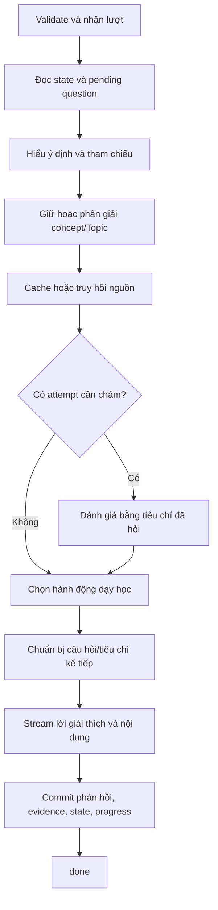

> Thiết kế trước hợp nhất. Quyết định hiện hành: chỉ một SocraticChatService; không còn cờ/facade chọn service. Tên class/config/seed đã chuẩn hóa; xem ARCHITECTURE.md và socratic-operator-guide.md. Các đoạn lộ trình chưa chứng minh đã chạy.

# Socratic Chat Socratic — kế hoạch nghiệp vụ và triển khai chi tiết

Ngày: 2026-11-01. Phiên bản tài liệu: 1.0.

**Trạng thái: thiết kế để người dùng đọc và duyệt triển khai. Không phải mã đã chạy.**

Tài liệu này triển khai chi tiết hướng đã thống nhất trong [decisions.md](decisions.md). Các tên lớp, chữ ký, JSON và thuật toán bên dưới là thiết kế đề xuất; thông số chưa đo là giá trị khởi đầu hoặc điểm cần chốt. Không tự mở rộng quyền triển khai từ tài liệu này.

## Mục lục

1. [Mục tiêu và định nghĩa thông minh](#1-mục-tiêu-và-định-nghĩa-thông-minh)
2. [Khoảng cách với code hiện tại](#2-khoảng-cách-với-code-hiện-tại)
3. [Kiến trúc code](#3-kiến-trúc-code)
4. [Mô hình một lượt](#4-mô-hình-một-lượt)
5. [API và khả năng tương thích](#5-api-và-khả-năng-tương-thích)
6. [State và bộ nhớ](#6-state-và-bộ-nhớ)
7. [Nhận diện ý định](#7-nhận-diện-ý-định)
8. [Nhận diện Topic](#8-nhận-diện-topic)
9. [Entity và truy hồi](#9-entity-và-truy-hồi)
10. [Đồ thị và nguồn](#10-đồ-thị-và-nguồn)
11. [Rubric và câu hỏi chờ](#11-rubric-và-câu-hỏi-chờ)
12. [Đánh giá mức độ hiểu](#12-đánh-giá-mức-độ-hiểu)
13. [Chính sách sư phạm](#13-chính-sách-sư-phạm)
14. [Ôn nền và quay lại](#14-ôn-nền-và-quay-lại)
15. [Luyện tập](#15-luyện-tập)
16. [Sinh phản hồi và prompt](#16-sinh-phản-hồi-và-prompt)
17. [Sơ đồ và artifact](#17-sơ-đồ-và-artifact)
18. [SSE](#18-sse)
19. [Hiệu năng và model](#19-hiệu-năng-và-model)
20. [DB và transaction](#20-db-và-transaction)
21. [Retry và đồng thời](#21-retry-và-đồng-thời)
22. [Tiến độ và ngộ nhận](#22-tiến-độ-và-ngộ-nhận)
23. [Lỗi và suy giảm chức năng](#23-lỗi-và-suy-giảm-chức-năng)
24. [Ví dụ hội thoại](#24-ví-dụ-hội-thoại)
25. [Các gói code](#25-các-gói-code)
26. [Nghiệm thu](#26-nghiệm-thu)
27. [Triển khai và điểm cần chốt](#27-triển-khai-và-điểm-cần-chốt)

## 1. Mục tiêu và định nghĩa thông minh

Sản phẩm là gia sư giúp người học hiểu, giải thích và vận dụng. Ưu tiên học khái niệm theo môn; hỗ trợ bài tập khi được yêu cầu. Không thay việc học bằng chuỗi hỏi ngược vô tận.

Một thay đổi chỉ được coi là cải thiện khi thể hiện được hành vi quan sát sau:

| Năng lực | Hành vi cần đạt |
|---|---|
| Giữ mạch | Hiểu “vì nó duy nhất” đang trả lời câu hỏi nào |
| Hiểu nhu cầu | Phân biệt xin ví dụ, trả lời, phản biện và chuyển chủ đề |
| Dạy vừa sức | Giải thích trước khi hỏi nếu người học chưa biết; tăng/giảm hỗ trợ |
| Chẩn đoán | Nhận ra thiếu tính tối tiểu thay vì chỉ nói “chưa đúng” |
| Công bằng | Chấp nhận lập luận hợp lệ khác đáp án mẫu; phân biệt đúng một phần |
| Biết giới hạn | Không bịa khi nguồn thiếu/mâu thuẫn; không tự tin chỉ vì vector gần |
| Học từ tương tác | Dùng bằng chứng trước đó để chọn câu hỏi, không hỏi lại máy móc |
| Kiểm tra chuyển giao | Kiểm tra trên tình huống mới thay vì đồng nhất nhắc lại với hiểu |
| Tự sửa | Tiếp nhận phản biện đúng của người học và sửa phát biểu trước |
| Ổn định | Retry/lỗi mạng không cộng điểm hai lần hoặc nhảy mục tiêu |

“Thông minh” không được suy ra từ nhiều agent, nhiều token hay sơ đồ đẹp. Chất lượng phải được người dùng kiểm tra qua tập tình huống ở mục 26. Tài liệu không cam kết độ chính xác tuyệt đối.

## 2. Khoảng cách với code hiện tại

Đã đọc các file liên quan; chưa chạy app/DB/LLM. Đối chiếu chính:

| Code hiện tại | Thay đổi Socratic |
|---|---|
| SocraticChatService gộp nhiều trách nhiệm | Orchestrator nhỏ, module có contract rõ |
| RouterEvaluationLLM chấm trước truy hồi | Hiểu ý định trước; chấm khi có tiêu chí và nguồn |
| Chọn concept theo chuỗi/ứng viên đầu | Phân giải entity có ngữ cảnh, giữ bất định |
| Nhúng và tìm vector mỗi lượt | Cache và đường tiếp nối theo pending question |
| ProcessStep là trung tâm mọi lượt | Concept objective là trung tâm CONCEPT; ExerciseStep cho EXERCISE |
| Không pass thường tăng stuck_count | Chỉ attempt sai có bằng chứng mới tăng |
| Lùi nền theo ngưỡng cố định | Chẩn đoán thiếu nền và lưu return stack |
| Repository chat tự commit từng thao tác | Unit of work cho thao tác hoàn tất lượt |
| Stream provider lỗi có thể fallback giữa chừng | Chỉ fallback trước nội dung đầu tiên |
| Một cờ completed | Tách hoàn tất lượt, mục tiêu, bài tập và tiến độ concept |

File tác động: app/service/socratic_chat_service.py, app/service/llm_service.py, app/api/deps.py, app/schema/chat_sse_schema.py, repository/mysql/chat_repo.py, repository/chroma/vector_repo.py, repository/neo4j và prompts/tutoring.

Không xóa toàn bộ mã cũ/src trong gói này. Không xây workflow duyệt rubric hoặc làm lại ingestion. Chỉ yêu cầu contract đầu ra ingestion mà chat cần.

## 3. Kiến trúc code

Đề xuất sử dụng thư mục tutoring hiện có, bổ sung module rõ chức năng:

```text
app/service/socratic_chat_service.py        # façade tương thích, điều phối
app/service/tutoring/
  turn_coordinator.py                     # nhận lượt, retry, lease, finalize
  intent_service.py                       # nhận diện nhu cầu và tham chiếu
  topic_context_service.py                # suy Topic, giữ và chuyển ngữ cảnh
  retrieval_service.py                    # entity/chunk/graph, chọn nguồn
  rubric_service.py                       # đọc hoặc lập tiêu chí tạm
  understanding_evaluator.py              # đánh giá có bằng chứng
  pedagogical_policy.py                   # quy tắc thuần Python
  learning_state_service.py               # transition và return stack
  prompt_builder.py                      # context theo nhiệm vụ
  response_generator.py                  # lời giải thích, câu hỏi kế tiếp
  progress_service.py                     # tổng hợp evidence
  artifact_service.py                     # bài tập/sơ đồ
  context_cache.py                       # cache có scope/version
app/schema/
  tutoring_contracts.py                   # DTO nội bộ Pydantic
  chat_sse_schema.py                      # public request/event
app/repository/mysql/
  topic_repo.py
  learning_state_repo.py
  evaluation_repo.py
  concept_progress_repo.py
app/repository/neo4j/
  exercise_repo.py
  rubric_repo.py
```

Các module trống search_local/search_global/llm_generator không tự trở thành dependency. Tránh dùng intent_router.py thử nghiệm có client toàn cục; thay đường gọi bằng module được inject rõ ràng. Không tạo tên class/file thứ hai có cùng trách nhiệm.

Đề xuất chữ ký, không phải SDK đã triển khai:

```python
IntentService.analyze(message, dialogue_view) -> IntentAnalysis
TopicContextService.resolve(intent, state, candidates) -> ContextResolution
RetrievalService.retrieve(query, context, access_scope) -> KnowledgeBundle
RubricService.prepare(question_goal, bundle) -> RubricSnapshot
UnderstandingEvaluator.evaluate(answer, pending, bundle) -> EvaluationResult
PedagogicalPolicy.decide(intent, evaluation, state, learner) -> TeachingAction
LearningStateService.transition(state, action, response) -> StatePatch
TurnCoordinator.finalize(turn, evaluation, response, state_patch) -> TurnReceipt
```

Quy tắc phụ thuộc: schema không gọi DB; policy không gọi LLM; repository không chọn chiến thuật; generator không ghi điểm; endpoint không chứa logic học tập. Orchestrator nhận dependency qua app/api/deps.py.

## 4. Mô hình một lượt



Giữ state đầu lượt làm snapshot bất biến. Không cập nhật active concept trong DB ngay khi vector trả về một ứng viên. Chỉ áp dụng patch đã được policy chọn và response xác nhận.

Pseudocode điều phối:

```python
async def stream_turn(req):
    receipt = await coordinator.accept(req)
    if receipt.is_replay:
        yield replay_event(receipt)
        return
    snapshot = await state_service.load(receipt.session_id)
    intent = await intent_service.analyze(req.message, snapshot.dialogue)
    context = await context_service.resolve(intent, snapshot)
    bundle = await retrieval.get_or_fetch(context, intent)
    evaluation = None
    if intent.should_evaluate and snapshot.pending_question:
        evaluation = await evaluator.evaluate(
            req.message, snapshot.pending_question, bundle
        )
    action = policy.decide(intent, evaluation, snapshot, bundle)
    plan = await generator.prepare(action, bundle, snapshot)
    async for event in generator.stream(plan):
        yield event
    committed = await coordinator.finalize(plan, evaluation, snapshot.version)
    yield done_event(committed)
```

Đây là happy path. Bản code thực phải có cancellation, timeout, lease, trạng thái lỗi và try/finally. Không diễn giải yield token là đã lưu thành công. done chỉ phát sau commit.

## 5. API và khả năng tương thích

Giữ route POST /api/v1/chat/socratic/stream. Các field hiện có tiếp tục được đọc. Không bắt buộc topic_id ở FE.

Đề xuất thêm:

| Field | Mục đích |
|---|---|
| client_request_id | Khóa ổn định khi retry cùng lượt |
| expected_state_version | Phát hiện thao tác trên màn hình cũ |
| reply_to_message_id | Tham chiếu câu hỏi cụ thể nếu FE hỗ trợ |
| protocol_version | Chọn mapping SSE tương thích |

Nếu chưa gửi client_request_id, backend cấp ID nhưng không thể bảo đảm retry từ client không bị nhận thành lượt mới. Với lượt mở session đầu tiên, đề xuất Gateway/FE cấp trước session_id và request_id; nếu không, cần contract tạo session idempotent riêng. Không hash nội dung làm khóa vì học sinh có thể cố ý gửi lại cùng câu.

Các active_* cũ là lựa chọn ngữ cảnh từ UI, không được override state vô thời hạn. Chuyển chúng thành lệnh focus rõ ở đầu lượt và kiểm tra tồn tại/liên hệ đúng dữ liệu. subject là giới hạn/ứng viên đáng tin theo contract, không tự khóa sai môn nếu do client suy đoán.

Thêm endpoint lấy kết quả lượt theo session/request sau mất mạng; schema cụ thể chốt với Gateway. Giữ API lịch sử hiện có, bổ sung trạng thái message mà không làm message thất bại trông như đáp án hoàn chỉnh.

## 6. State và bộ nhớ

Ba tầng nhớ:

1. Working state: Topic/concept/mode/objective, pending question, hint, nguồn và stack.
2. Dialogue memory: vài lượt gần liên quan và summary đã lưu; giữ đề bài gốc khi đang giải.
3. Learner memory: tiến độ và ngộ nhận có bằng chứng theo concept.

Không đưa toàn bộ lịch sử vào prompt theo số message cố định. Đóng gói theo token budget và ưu tiên: câu hỏi pending -> câu trả lời mới -> đề bài/định nghĩa -> tiêu chí -> lượt liên quan -> summary. Không cắt mất giả thiết hoặc điều kiện chỉ để đủ top-k.

State JSON cần schema_version, Pydantic validation và cách nâng phiên bản. Không lưu cache object hoặc suy luận dài vào DB.

PendingQuestion đề xuất:

```json
{
  "question_id": "uuid",
  "assistant_message_id": "uuid",
  "text": "Nếu bỏ một thuộc tính mà vẫn duy nhất thì tập ban đầu đã tối tiểu chưa?",
  "canonical_code": "KHOA_UNG_VIEN",
  "objective": "CONDITIONS",
  "criterion_codes": ["MINIMALITY"],
  "rubric_snapshot": {},
  "source_refs": [],
  "hint_level_used": 1,
  "question_type": "YES_NO_WITH_REASON",
  "status": "OPEN"
}
```

Text lưu ở assessment_context phải là câu hỏi thực đã phát; field pending_question_message_id vẫn là tham chiếu chính. Kiểm tra text khớp response trước commit, không có hai bản tự chỉnh độc lập.

Khi xin ví dụ: giữ mục tiêu cũ, thay câu hỏi pending chỉ khi thực sự hỏi câu mới. Khi đổi concept: xóa process/step không phù hợp. Khi quay lại: phục hồi snapshot nhưng kiểm tra nguồn/phiên bản còn dùng được.

Summary không tự khẳng định học sinh đã hiểu; chỉ tổng hợp điều có evidence. Có thể cập nhật định kỳ bằng structured result; nếu phải gọi LLM riêng thì tính vào chi phí, không giấu thành tác vụ miễn phí.

## 7. Nhận diện ý định

IntentAnalysis gồm primary_intent, secondary_intents, refers_to_pending, topic_change_evidence, standalone_query, mentioned_entities và needs_clarification. Hỗ trợ tin nhắn nhiều ý; chọn một mục tiêu chính, giữ yêu cầu phụ để phản hồi hoặc hẹn xử lý tiếp.

Nhóm intent: ASK_DEFINITION, ASK_WHY, COMPARE, REQUEST_EXAMPLE, ANSWER_PENDING, REQUEST_HINT, EXPRESS_CONFUSION, CHALLENGE_TUTOR, REQUEST_EXERCISE, REQUEST_DIAGRAM, SWITCH_TOPIC, CLOSE_DISCUSSION.

- Action chip rõ ràng giúp chọn intent nhưng không ép verdict đúng/sai.
- Không dùng độ dài hoặc vài từ khóa như “không” để quyết định câu trả lời sai.
- Có pending thì câu ngắn được hiểu trong cặp hỏi–đáp; không tự mặc định mọi tin nhắn sau đó đều là đáp án.
- “Không hiểu, cho em ví dụ về khóa chính” vừa xin hỗ trợ vừa có thể đổi concept; cần phân giải nội dung trước đánh giá.
- CHALLENGE_TUTOR kích hoạt đối chiếu lại nguồn, không tăng failed_attempts.
- Nếu có lời chào/kết thúc rõ thì không gọi embedding/evaluator vô ích.

Đường đầy đủ dùng model nhỏ có structured output. Đường rõ từ action chip và state có thể dùng quy tắc. Intent mơ hồ được hỏi lại hoặc đưa vào evaluator chung nếu bundle đã sẵn; tránh một call router riêng chỉ để lập lại thông tin đã biết.

## 8. Nhận diện Topic

Topic do AI tạo theo chunk có thể trùng, quá nhỏ hoặc lệch summary. Không yêu cầu user/FE chọn trước và không merge Topic nguồn trong chat.

Thuật toán đề xuất:

1. Phân giải entity/ứng viên chunk theo tin nhắn và ngữ cảnh.
2. MySQL join topic_chunks với các chunk ID để lấy Topic ứng viên; thêm Topic chứa canonical code đã xác minh.
3. Xếp hạng bằng thứ hạng chunk, độ phủ concept, liên quan summary và độ liên tục hội thoại.
4. Tránh Topic có nhiều chunk tự thắng do kích thước: dùng top evidence/độ phủ chuẩn hóa, không cộng vô hạn.
5. Nếu cần, gọi phân giải một lần trên danh sách ngắn; model chỉ được chọn ID có trong danh sách.
6. Lưu active_topic_id và candidates trong state; khi bất định có thể giữ null.

Điểm Topic là điểm xếp hạng, không phải xác suất đúng. Không gán trọng số cố định thành chân lý; cấu hình và hiệu chỉnh khi người dùng chạy tập đánh giá.

Chống đổi Topic liên tục: yêu cầu bằng chứng chuyển chủ đề rõ hoặc lợi thế ứng viên đủ theo cấu hình. Câu hỏi phụ/ôn nền không thay Topic gốc. Giữa hai Topic gần nhau cùng hỗ trợ một câu trả lời, cứ dùng nguồn liên quan, không bắt học sinh chọn tên Topic kỹ thuật.

Query ví dụ (logic, cần đối chiếu ORM thực):

```sql
SELECT t.id, t.name, t.summary, t.concepts_included, tc.chunk_id
FROM topics AS t
JOIN topic_chunks AS tc ON tc.topic_id = t.id
WHERE tc.chunk_id IN (...);
```

Phân trang/batch ID; cân nhắc index (chunk_id, topic_id) sau khi đối chiếu index thật. Không quét toàn bộ summary và JSON mỗi tin nhắn.

## 9. Entity và truy hồi

Entity collection chứa canonical_code, tên, subject, description và alias nếu nguồn có. Alias không tự thêm bền vững từ model trong chat. Phiên bản/entity description phải phân biệt nguồn tổng quát với nội dung riêng giáo viên; không nhúng nội dung riêng vào collection chung thiếu scope.

RetrievalQuery gồm intent, subject_candidates, topic_candidates, active_concepts, query_text, material_constraints, teacher_scope và required_evidence_types.

Đường tìm entity: exact code/name/alias -> semantic candidates -> giải nghĩa theo câu hỏi/Topic. Từ đồng nghĩa tiếng Việt/Anh dùng alias hoặc semantic, không sửa mã canonical bằng bỏ dấu tùy tiện.

Chunk retrieval có hai lane khi cần: trong Topic và mở rộng trong môn/phạm vi cho phép. Nếu Topic chưa chắc, chạy global subject lane trước để suy Topic. Hợp nhất bằng thứ hạng như reciprocal rank fusion hoặc scoring rõ nguồn; không cộng cosine của các chỉ mục khác mô hình rồi coi cùng thang.

Similarity cosine = 1 - distance chỉ khi collection thực dùng cosine. Khi thiếu distance, coi score chưa biết; không mặc định perfect match. Kiểm tra metric/model/dimension thực ở đầu triển khai, không cho rằng get_or_create tự chuyển metric của collection cũ.

Áp ngưỡng + đủ nguồn + khoảng cách giữa ứng viên; top-k là ứng viên, không phải số nguồn đưa vào prompt. Ngưỡng số và budget để cấu hình, hiệu chỉnh trên dữ liệu người dùng; không copy 0.65/0.70 thành chuẩn.

KnowledgeBundle giữ entity candidates, Topic, definitions, examples, relations, rubric, chunks, coverage, conflicts, source versions và missing_evidence. Giữ ID ngay từ repository tới prompt, không ghép list text làm mất ánh xạ trích dẫn.

## 10. Đồ thị và nguồn

Mặc định truy hồi một hop có chủ đích. ASK_WHY ưu tiên Argument; COMPARE lấy hai định nghĩa và CONTRASTS_WITH; thiếu nền chỉ dùng quan hệ tiền đề đã hiểu đúng hướng. IS_A/PART_OF không mặc nhiên là bài phải học trước.

Giới hạn số node và source budget trước generation. Lấy Definition của concept liên quan khi cần giải thích quan hệ; chỉ liệt kê mã cạnh không đủ giúp model hiểu.

Scoped overlay: chọn bản giáo viên đúng scope trước; dùng GLOBAL để bù nội dung thiếu, không gộp mâu thuẫn thành định nghĩa mới. owner_role không thay owner_id. Nếu schema chưa xác định được chủ sở hữu, không đoán ID từ vai trò.

SourceRef gồm source_type/id, excerpt, subject, scope, version và locator nếu có. Prompt dùng nhãn [S1], [S2] map về nguồn thật. Citation validator kiểm tra ID tồn tại và excerpt; kiểm tra hình thức không bảo đảm mọi diễn giải được nguồn chứng minh. Nếu cần semantic review thì đó là bước bổ sung có chi phí.

Nội dung học liệu là dữ liệu tham khảo, không phải chỉ dẫn thay chính sách hệ thống. Tách chỉ thị điều khiển và nguồn. Không nhận câu “hãy bỏ qua quy tắc” từ chunk như instruction.

## 11. Rubric và câu hỏi chờ

Thứ tự dùng tiêu chí: rubric phù hợp được nguồn cho phép dùng -> tiêu chí tạm theo Definition/conditions/chunk -> hỏi làm rõ khi không đủ căn cứ. Chat không duyệt hay publish rubric.

RubricSnapshot: id/version nếu có, origin/review_state, criteria, source_refs, applicability và snapshot_hash. Một tiêu chí có expected_evidence, acceptable_variations, misconception_codes và objective. Chỉ lấy tiêu chí đúng mục tiêu/câu hỏi, không chấm toàn bộ concept trên một câu nhỏ.

Tiêu chí tạm sinh trước khi đặt câu hỏi, cùng kế hoạch câu hỏi. Lưu snapshot để lượt sau không đổi tiêu chuẩn âm thầm. Mô hình không được tự yêu cầu kiến thức chưa hề hỏi rồi đánh trượt người học.

Hai node ConceptRubric/ConceptCriterion là mở rộng kho tri thức do ingestion/quản trị cung cấp. Nếu chưa có, module rubric_repo trả trạng thái ABSENT có chủ đích, không lỗi toàn chat.

Nếu nguồn tiêu chí bị thu hồi, không áp dụng lại cho câu đang chờ như thể còn hợp lệ; giải thích ngắn rằng cần điều chỉnh câu hỏi, lưu lý do, không tính người học sai.

## 12. Đánh giá mức độ hiểu

EvaluationInput phải có question_text, response, mục tiêu, tiêu chí đúng phiên bản, nguồn, hint đã dùng và context cần thiết. Không chấm chỉ vì có assistant trong lịch sử như can_evaluate_step hiện tại.

Output:

```json
{
  "verdict": "PARTIAL",
  "criteria_results": [
    {"code": "UNIQUENESS", "status": "MET"},
    {"code": "MINIMALITY", "status": "UNCLEAR"}
  ],
  "evidence": [{"criterion": "UNIQUENESS", "student_excerpt": "xác định duy nhất"}],
  "missing_elements": ["Chưa thể hiện tính tối tiểu"],
  "misconception_candidates": [],
  "needs_more_evidence": false
}
```

Validate code tiêu chí nằm trong snapshot, trích đoạn có trong câu trả lời, câu hỏi khớp pending. Nếu model trả mã ngoài tập hoặc cấu trúc sai: sửa có giới hạn; vẫn lỗi thì UNCLEAR/không cập nhật điểm. Không mặc định INCORRECT.

| Verdict | Tác động state |
|---|---|
| CORRECT | Ghi tiêu chí đạt; xét độc lập; có thể chuyển mục tiêu |
| PARTIAL | Giữ phần đã đạt, hỏi phần thiếu; không chấm lại phần đúng vô ích |
| INCORRECT | Tăng failed_attempts có điều kiện và chọn hỗ trợ |
| UNCLEAR | Hỏi làm rõ; không tăng failed_attempts |
| NOT_AN_ATTEMPT | Thực hiện nhu cầu hỗ trợ |
| INSUFFICIENT_EVIDENCE | Lấy nguồn hoặc đặt câu chẩn đoán, không phán xét |

Sai cần phân biệt lỗi khái niệm, thao tác và thiếu dữ kiện. Không gắn ngộ nhận lâu dài từ typo. Có thể trả nhiều bằng chứng cho nhiều tiêu chí, nhưng mỗi lượt chỉ chủ động hỏi một trọng tâm.

Escalation khi nguồn mâu thuẫn, lời giải khác mẫu hoặc evaluator không đủ căn cứ: truy hồi thêm/second review có giới hạn; không gọi mô hình mạnh cho mọi lượt. Nếu còn không chắc, nói chưa đủ căn cứ. Bộ kiểm chứng toán/SQL chuyên biệt là gói sau, không thực thi tùy ý code người học.

## 13. Chính sách sư phạm

TeachingAction có action_type, target_concept/objective, explanation_goal, question_spec, hint_level, preserve_pending, evidence_refs và progress_patch đề xuất. Policy là hàm xác định từ dữ liệu đầu vào; model không tự commit state.

Ưu tiên quyết định:

1. Nguồn thiếu/mâu thuẫn: khắc phục bằng chứng trước.
2. Người học phản biện: kiểm tra phát biểu AI trước.
3. Người học muốn dừng/đổi: tôn trọng và lưu điểm dang dở khi phù hợp.
4. Xin giải thích/ví dụ: hỗ trợ, không chấm sai.
5. Attempt: phản hồi theo verdict và hỗ trợ đã dùng.
6. Không có câu hỏi kiểm tra: trả lời nhu cầu trước, mời kiểm tra nếu có ích.

Mức hint 0..4 như tutoring-policy.md. Đúng có gợi ý mạnh chỉ ghi supported success. Giảm hint khi có nhiều bằng chứng độc lập, không vì bước số 2 hay stuck_count = 0 tự suy đã giỏi.

Chống vòng lặp: ghi question_type, target_criterion, strategy và số lần không tiến triển. Khi lặp lại cùng thiếu hụt, đổi biểu diễn hoặc giải thích trực tiếp ngắn; không chỉ tăng số câu hỏi. Sau ngưỡng cấu hình, hỏi người học muốn ôn nền hay xem ví dụ khác; không buộc backtrack.

“Luôn đúng một câu hỏi in đậm” được thay bằng quy tắc: nếu cần người học trả lời thì một câu hỏi rõ; lời chào, kết thúc và câu trả lời tra cứu có thể không cần câu hỏi. Không khen quá mức hay chúc hoàn thành concept chỉ vì một lần đúng.

## 14. Ôn nền và quay lại

Trigger là evidence về prerequisite gap, không đơn thuần số lần sai. Chọn khái niệm tiền đề qua cạnh đúng nghĩa và kiểm tra ngắn nếu chưa chắc.

Push frame đầy đủ: Topic/concept/mode/objective/pending question, rubric version, exercise/step, hint và lý do chuyển. Chỉ push khi thực sự chuyển, chống trùng frame; visited set và max depth cấu hình.

Khi ôn xong: kiểm tra mục tiêu nền đủ cho câu hỏi gốc, pop frame, kiểm tra nguồn còn hợp lệ và tiếp tục đúng điểm. Không bắt quay Process bước 1. Nếu người học đổi ý trong lúc ôn, tạm lưu nhánh cũ thay vì ép quay lại.

Nếu không có Process cho concept nền, vẫn ôn bằng Definition/Example. Không gán process cũ sang concept mới. Nếu graph không có nền tin cậy, hỗ trợ tại chỗ.

## 15. Luyện tập

Ưu tiên Exercise có sẵn phù hợp concept/objective/độ khó. Đọc ExerciseStep theo exercise_id và step_number; phân biệt process_step_id là liên hệ phương pháp chung, không thay nội dung bước cụ thể.

instruction phục vụ nhiệm vụ; expected_outcome để chấm; socratic_question là gợi ý mẫu; common_mistake chỉ là khả năng, không bằng chứng học sinh mắc lỗi. Cho phép lời giải hợp lệ khác trình tự mẫu và kiểm tra tiêu chí đạt trước khi nhảy nhiều bước.

Bài người học tự nhập: hỏi giả thiết thiếu, giữ đề gốc, lập kế hoạch tạm. Không phát minh dữ kiện để có đáp án. Không ghi nó thành Exercise chuẩn.

Bài AI tạo gồm public_statement, target_criteria, internal_solution, validation_result và origin. Sinh ví dụ tương tự, tránh sao lại bài đang làm chỉ thay tên. Validate tính đủ dữ kiện và nhất quán đáp án; model tự kiểm tra chỉ là kiểm tra AI, không bảo đảm toán học. Bài chưa đủ chắc không gửi như đã xác minh.

Chưa có nơi lưu artifact trong ba bảng SQL nháp. Đề xuất bổ sung metadata JSON vào message để lưu bài tạm và tham chiếu answer key ở vùng nội bộ; API public phải lọc bằng schema allowlist. Nếu không có bộ lưu nội bộ tách rõ, hoãn gửi bài sinh nhiều bước thay vì lộ answer key qua lịch sử.

## 16. Sinh phản hồi và prompt

Tách prompt theo vai trò: intent, evaluation, question planning, response và artifact. Các file ingestion giữ nguyên trong gói chat.

Response prompt có: chính sách dạy học -> TeachingAction -> nguồn được chọn -> learner facts có evidence -> hội thoại cần thiết. Không nhồi mọi Process/Example vào mọi lượt. Đưa code mẫu/đáp án vào vùng nội bộ cần thiết, không dựa duy nhất vào một dòng “cấm lộ” để ngăn trả đáp án.

Vấn đề cần xử lý kỹ: câu hỏi được lưu phải là câu thực sự đã gửi. Đề xuất:

- Khi phải tạo câu kiểm tra mới, prepare structured QuestionSpec cùng tiêu chí và exact question text.
- Stream phần giải thích bằng generator; câu hỏi cuối được nối từ exact text đã chuẩn bị.
- Validator bắt trường hợp generator tự thêm câu kiểm tra khác hoặc mớm đáp án trái policy.
- Nếu muốn diễn đạt lại câu hỏi, phải cập nhật text và tiêu chí tương ứng trước finalize, không dùng hai phiên bản khác nhau.

Question planning có thể gộp output với evaluator khi bundle và mục tiêu đủ rõ. Nếu cần một call riêng thì phải ghi vào latency; không hứa mọi lượt chỉ có hai call.

Chọn trade-off: token stream trực tiếp chưa được hậu kiểm toàn bộ, nên không thể vừa phát tức thời vừa bảo đảm mọi câu đã qua reviewer. Với bài sinh/đáp án nội bộ/diagram, buffer và validate trước gửi; với giải thích thường dùng prompt, schema nguồn và kiểm tra phần câu hỏi. Chế độ review toàn văn trước phát có thể là cấu hình chậm hơn, không mặc định che giấu chi phí.

## 17. Sơ đồ và artifact

Phiên bản đầu ưu tiên sơ đồ 2D. Chỉ tạo khi người học yêu cầu hoặc biểu diễn giúp mục tiêu cụ thể, không vẽ Mermaid bắt buộc mỗi lượt.

ArtifactPlan gồm type, learning_goal, public_data và source_refs. Chọn tập loại được renderer hỗ trợ. Không render văn bản đầu vào thành HTML tùy ý. Validation cấu trúc/renderer không chứng minh ý nghĩa khoa học đúng; cần đối chiếu node/quan hệ với KnowledgeBundle.

Sinh -> validate -> lưu -> phát diagram_ready/exercise_ready. Khung chờ hiển thị khi đang làm. Nếu lỗi, gửi thông báo ngắn và giải thích bằng văn bản; không làm hỏng cả lượt nếu phần chính còn hữu ích.

FE renderer chưa biết: không khóa một semantic JSON tự bịa. P0/P6 chốt schema_version và loại sơ đồ trước khi code artifact. 3D ngoài gói đầu.

## 18. SSE

Giữ các event cũ; protocol Socratic bổ sung turn_id và sequence, không bọc payload cũ vào envelope mới nếu chưa mapping Gateway.

Ví dụ status:

```text
event: status
data: {"turn_id":"uuid","sequence":2,"stage":"retrieving_materials","state":"running","message":"Đang tìm học liệu liên quan…"}
```

Stage theo tác vụ thực: understanding_request, retrieving_materials, connecting_concepts, evaluating_answer, preparing_explanation, generating_exercise, validating_exercise, generating_diagram. Mỗi stage có running/completed/failed; có thể một số stage chạy song song nên UI không suy thứ tự cố định.

Token không chứa status. Status không ghi vào content chat hay prompt history. context_ref chỉ đưa nguồn hợp lệ. Artifact chỉ gửi public payload. Heartbeat là comment/ping kết nối, không giả làm AI đang suy nghĩ.

done có full_content đã lưu, message_id, turn_id, state_version và các trạng thái học công khai phù hợp. Nếu commit lỗi sau token, phát error với thông tin phản hồi chưa được lưu; FE không xem là hoàn tất. Không phát done trước transaction.

Không stream chain-of-thought. Có thể báo “Đang đối chiếu với tính tối tiểu”, không phát các phỏng đoán chẩn đoán chưa chốt hay lời giải nội bộ.

## 19. Hiệu năng và model

Ba đường xử lý: tiếp nối giải thích thường 1 call khi bundle đủ; đánh giá thường evaluator + generator; chủ đề mới intent/disambiguation + retrieval + generator, có thể thêm QuestionSpec. Fast path không bỏ qua bằng chứng chỉ để đạt số call.

Lựa chọn model theo nhiệm vụ thay vì bool use_extraction_model hiện tại: INTENT, EVALUATION, RESPONSE, QUESTION_PLAN, ARTIFACT, EMBEDDING. Không đổi API/SDK chỉ vì muốn refactor; đối chiếu version cài đặt lúc triển khai.

Không chốt model thương mại cụ thể trong kế hoạch. Structured output cần xử lý refusal, rỗng, JSON lỗi và retry giới hạn. Timeout/retry budget tổng tránh nhiều tầng retry nhân lên.

Cache kiến thức theo scope/teacher/material limits/subject/concept/nguồn version/model embedding. Không cache câu trả lời cá nhân để dùng cho người khác. TTL chỉ là fallback khi ingestion chưa có version notification; snapshot câu hỏi vẫn giữ tiêu chí đã hỏi.

Chạy song song fetch độc lập bằng session riêng hoặc query batch. Không dùng chung SQLAlchemy AsyncSession/Neo4j session cho các tác vụ đồng thời chưa được hỗ trợ. Không mở transaction trong toàn bộ thời gian chờ LLM. Chroma persistent sync I/O cần đưa ra khỏi event loop theo adapter phù hợp.

Budget cho context, output, số hop, số nguồn, call và timeout là cấu hình. Khi quá budget: thu hẹp nguồn, trả lời trọng tâm/hỏi rõ, không cắt mất điều kiện rồi chấm chắc chắn.

Đo: thời gian nhận request, status đầu, retrieval, evaluation, token nội dung đầu, commit, hoàn tất; cache hit, calls, usage nếu provider có trả. Dùng số tổng hợp không lộ nội dung cá nhân. Không cam kết dưới một mốc giây chưa đo.

## 20. DB và transaction

Ba bảng đã chọn giữ vai trò như data-contracts.md. SQL trong chat trước chưa đủ để giải quyết toàn vòng đời lượt; trước migration cần bổ sung contract vận hành dưới đây.

Đề xuất sửa message hiện có, không tự thêm bảng thứ tư:

| Bổ sung dự kiến | Mục đích |
|---|---|
| turn_id | Cùng ID cho user/assistant của một lượt |
| turn_status | PROCESSING, COMPLETED, FAILED; dùng nhất quán theo vai trò |
| content_status | DRAFT/PARTIAL/FINAL nếu lưu phần sinh dở |
| turn_metadata JSON | request fingerprint, phiên bản, lỗi công khai, artifact public và pending spec phù hợp |
| unique(session_id, turn_id, role) | Chống tạo trùng user/assistant |

Cần chốt field nào public; internal rubric/answer key không được rò qua model_validate ORM tự động. Lượt đầu nên có session_id ổn định từ Gateway để unique có hiệu lực xuyên retry.

Thêm active_turn_id/lease_expires_at hoặc operational JSON tương đương trong learning_state để giữ một lượt đang chạy. Đây là sửa đổi SQL nháp đề xuất, không phải schema người dùng đã tạo.

Transaction A ngắn: đảm bảo session/state tồn tại -> nhận khóa state -> kiểm tra turn trùng/đang chạy -> lưu user message và receipt -> commit.

Ngoài transaction: phân tích, retrieval, LLM và stream. Lease renewal dùng kết nối riêng ngắn; không giữ row lock xuyên SSE.

Transaction B: xác minh turn/lease/version -> lưu assistant FINAL -> insert evaluation nếu mới -> cập nhật progress/ngộ nhận đủ điều kiện -> patch state/pending -> clear lease và mark complete -> commit. Repository mới dùng flush, không tự commit; UoW quản lý ranh giới.

Không gọi lại repository add_message đang tự commit bên trong B; phải thêm phương thức không commit hoặc refactor caller rõ. Tác vụ commit cuối không được đồng thời chạy trên cùng session với heartbeat DB.

## 21. Retry và đồng thời

- Một session xử lý một lượt học tại một thời điểm. Request mới trong khi lượt khác chạy trả lỗi/conflict có thể xử lý trên UI, không tự xếp hàng chưa có hạ tầng.
- Cùng turn_id và cùng fingerprint: nếu complete, replay kết quả; nếu running, trả trạng thái và cách lấy kết quả; nếu failed, cho retry có kiểm soát.
- Cùng turn_id khác nội dung: từ chối xung đột, không thay câu trả lời cũ.
- Lease hết hạn cho phép recovery, nhưng worker cũ phải bị chặn commit bằng owner token/version. Khóa trong RAM không đủ khi có nhiều worker.
- Unique evaluation chỉ ngăn insert trùng; code chỉ tăng counter khi insert mới thành công. Không update progress trước khi biết có evidence mới.
- Hai session của cùng user cập nhật cùng concept: khóa row progress hoặc optimistic version/retry transaction ngắn, tránh lost update.

Disconnect đề xuất cho gói đầu: hủy generator, rollback phần chưa finalize, đánh dấu lượt FAILED/CANCELLED theo contract; phần token đã phát chỉ là bản dở. Nếu commit đã xong trước disconnect, retry lấy bản hoàn tất. Không hứa vẫn chạy nền sau mất kết nối nếu chưa có job runner bền vững.

Nếu về sau yêu cầu tiếp tục xử lý nền, đó là gói riêng với worker/outbox/queue và retention; không dùng fire-and-forget để giả bảo đảm hoàn tất.

## 22. Tiến độ và ngộ nhận

Progress lưu bằng chứng, không chứng nhận năng lực tuyệt đối. Với câu hỏi quá nhỏ, chỉ cập nhật objective/criterion đã kiểm tra. NOT_AN_ATTEMPT/UNCLEAR/lỗi không tăng số assessment có giá trị.

Đề xuất giai đoạn đầu: status NOT_ASSESSED -> DEVELOPING -> DEMONSTRATED theo nhiều quan sát độc lập và độ phủ tiêu chí; số quan sát tối thiểu để cấu hình/chốt. Mastery_level giữ NULL nếu chưa có scoring_version được chấp thuận. Không mặc định một đáp án đúng = 1.0.

Khi cần chỉ số số học: xác định tập tiêu chí áp dụng, trọng số, mức hỗ trợ và cửa sổ quan sát; ghi scoring_version và coverage riêng. Không đồng nhất “chưa kiểm tra” với “sai”, không tự giảm vì thời gian trôi nếu chưa chọn mô hình quên.

Ngộ nhận: mã + concept + bằng chứng phát hiện + trạng thái SUSPECTED/CONFIRMED/RESOLVED + evidence khắc phục. Cần bổ sung field bảng cũ sau duyệt. Chỉ resolve lỗi đã được hỏi kiểm tra lại, không đóng toàn concept vì hoàn thành Process.

Rubric reviewed và evaluation reviewed là hai chuyện. Lưu nguồn AI/giáo viên và review snapshot; không retroactively nâng mức xác nhận khi rubric được duyệt sau. Không chuyển điểm heatmap cũ thành bằng chứng độc lập nếu không có mapping hợp lệ.

## 23. Lỗi và suy giảm chức năng

| Lỗi | Phản ứng |
|---|---|
| Không tìm Topic | Giữ concept/nguồn, Topic null, không dừng chat |
| Entity không rõ | Hỏi phân biệt hoặc giải thích có giới hạn |
| Chroma lỗi | Exact lookup/nguồn đã có nếu đủ, không giả semantic search thành công |
| Neo4j lỗi | Dùng chunk đã xác thực để giải thích; không chấm theo rubric thiếu |
| Không có rubric | Tiêu chí tạm theo nguồn, lưu origin |
| Evaluator lỗi | Không cộng điểm/đánh sai; hỗ trợ hoặc hỏi làm rõ |
| LLM lỗi trước token | Retry/fallback trong budget |
| LLM lỗi sau token | Kết thúc lỗi; không ghép provider thứ hai |
| MySQL không lưu được | Không done; báo phản hồi chưa lưu |
| Artifact lỗi | Fallback văn bản nếu có ích |
| Nguồn mâu thuẫn | Nêu khác biệt, không chốt một kết luận bịa |

Không trả raw exception/credential cho FE. Mã lỗi công khai ổn định, log có correlation ID. Hạ tầng/lỗi vận hành không trở thành ngộ nhận người học.

## 24. Ví dụ hội thoại

### A. Học khái niệm mới

User: “Khóa ứng viên là gì?”

Backend: resolve entity -> suy Topic qua chunk -> Definition/Example -> EXPLAIN_THEN_CHECK, không evaluation lượt đầu.

AI: giải thích tính duy nhất và tối tiểu bằng ví dụ ngắn. Nếu phù hợp, hỏi một câu nhận diện. Lưu exact question + criterion. Không đánh dấu user đã hiểu chỉ vì đã đọc lời giải thích.

### B. Đúng một phần

User: “Nó xác định duy nhất từng dòng.”

Evaluator: UNIQUENESS MET, MINIMALITY chưa thể hiện; PARTIAL nếu câu hỏi yêu cầu đủ hai ý. Nếu câu hỏi chỉ hỏi tính duy nhất thì CORRECT cho tiêu chí đó, không tự nâng yêu cầu.

AI: “Ý xác định duy nhất là đúng. Nếu bỏ một thuộc tính mà vẫn giữ được điều đó, tập ban đầu đã tối tiểu chưa?” Không dùng phản ứng “sai rồi” và không đóng toàn concept.

### C. Xin hỗ trợ

User: “Em chưa hiểu tối tiểu.”

Intent REQUEST_EXPLANATION, không failed_attempts. AI đưa ví dụ khác, chia nhỏ; có thể thay câu hỏi pending bằng câu dễ hơn và ghi hint level tăng.

### D. Đổi concept trong cùng Topic

User: “Thế siêu khóa khác gì?”

Intent COMPARE, lấy hai concept; giữ Topic nếu evidence phù hợp. Không reset như đổi môn. Lưu tập concept được nhắc nhưng chọn trọng tâm câu hỏi rõ.

### E. Người học đúng, AI sai

User đưa phản ví dụ cho phát biểu trước. CHALLENGE_TUTOR -> kiểm tra nguồn -> sửa phát biểu và đánh giá bị ảnh hưởng. Không tăng misconception. Nếu phải chấm lại evidence cũ, dùng revision/recompute có thiết kế, không insert trùng để cộng điểm.

### F. Ôn nền rồi quay lại

Đang làm BCNF, phát hiện chưa hiểu siêu khóa. Push frame đề bài/bước/câu hỏi; ôn siêu khóa; hỏi kiểm tra đủ; pop frame và nối kiến thức vào câu hỏi BCNF dang dở, không quay bài từ đầu.

### G. Đề nghị vẽ sơ đồ

REQUEST_DIAGRAM -> ArtifactPlan theo mục tiêu -> status thật -> payload validate -> diagram_ready. Nếu FE không hỗ trợ loại sơ đồ, dùng bảng/văn bản, không phát schema không render được.

## 25. Các gói code

Mỗi gói bàn giao riêng sau khi được phép. Không cần người dùng duyệt lặp lại gói đã cho phép, nhưng thay đổi schema/phạm vi đáng kể phải ghi rõ. Giữ P0–P7 trong TASK.md, chia nhỏ như sau:

| Gói | File/đầu việc chính | Phụ thuộc | Tiêu chí review |
|---|---|---|---|
| P0.1 | Đối chiếu DDL, ID, scope/cạnh Neo4j và SQL ba bảng | Mẫu schema thực | Không đoán FK/cạnh; có mapping |
| P0.2 | Chốt request/turn, message metadata, lease, xóa dữ liệu | P0.1 | Không tự thêm bảng thứ tư; thay đổi cột minh bạch |
| P0.3 | DTO contract/prompt policy và protocol version | P0.1 | Không lẫn data nội bộ/public |
| P1.1 | Model Topic/topic_chunks/state/evaluation/progress | P0 | Khớp DDL đã duyệt |
| P1.2 | Repository + UoW không tự commit | P1.1 | Atomic finalize, session lifetime rõ |
| P1.3 | Backfill state và compatibility adapter | P1.2 | Không hai nguồn state/điểm |
| P2.1 | Entity schema/description, hai collection, embed cố định | P0.1 | Model/dimension metadata đúng |
| P2.2 | Topic resolver, query rewrite, candidate ranking | P2.1 | Topic tự nhận diện, không nhảy nhiễu |
| P2.3 | KnowledgeBundle, graph retrieval, cache/version | P2.2 | Truy vết nguồn và phạm vi |
| P3.1 | IntentAnalysis/PendingQuestion/RubricSnapshot | P1/P2 | Hỏi gì chấm nấy |
| P3.2 | Evaluator, validation và escalation giới hạn | P3.1 | Không default lỗi thành sai |
| P3.3 | Policy thuần Python + state transitions | P3.2 | Hỗ trợ đúng một phần/không hiểu |
| P4.1 | PromptBuilder và ResponsePlan/QuestionSpec | P3 | Exact question khớp pending |
| P4.2 | SSE status, compatibility, error terminal | P4.1 | Status thật, không ghép provider |
| P4.3 | TurnCoordinator lease/retry/finalize | P1/P4.2 | Không trùng hoặc stale commit |
| P5.1 | Progress evidence aggregation/heatmap adapter | P4.3 | Counter idempotent, score chưa đo không bịa |
| P5.2 | Misconception evidence và return stack | P3/P5.1 | Resolve đúng lỗi, quay đúng chỗ |
| P6.1 | ExerciseRepository/schema và step evaluation | P3/P0.1 | Đọc đúng expected_outcome |
| P6.2 | Bài tạm, lưu nội bộ/public, kiểm tra trước gửi | P6.1 | Không lộ answer key, không nhập kho chuẩn |
| P6.3 | DiagramPlan/schema FE/validator/event | P4/P0.3 | Artifact hoàn chỉnh hoặc fallback |
| P7.1 | Cấu hình mẫu, hướng dẫn migration/tự chạy | Các gói đã chọn | Không secret, rollback không phá evidence |
| P7.2 | Tập tình huống và báo cáo bàn giao | P7.1 | Ghi chưa chạy, chờ kết quả user |

Mỗi gói cần liệt kê file tạo/sửa thực tế, contract thay đổi, giả định và việc chưa làm. Tạo report theo đợt, cập nhật TASK. Không rewrite service thành một lần quá lớn khó review.

## 26. Nghiệm thu

Người dùng tự chạy; agent chuẩn bị fixture và kịch bản khi gói được duyệt. Hiện chưa có kết quả pass/fail.

| Nhóm | Tình huống tối thiểu | Điều kiện đạt |
|---|---|---|
| Khái niệm | Hỏi mới không biết gì | Giải thích dễ tiếp cận trước khi kiểm tra |
| Ngữ cảnh | “Không ạ”, “vì duy nhất” | Đúng pending, không nhúng câu cụt vô ngữ cảnh |
| Đánh giá | Đúng một phần/lập luận khác mẫu | Ghi đúng tiêu chí, không bác đáp án hợp lệ |
| Hỗ trợ | Xin ví dụ liên tiếp | Đổi hỗ trợ, không tăng sai giả |
| Topic | Nhiều Topic trùng theo chunk | Không bắt chọn ID kỹ thuật, không nhảy mạch |
| Nguồn | Sai/thiếu/mâu thuẫn | Bộc lộ giới hạn, không tạo nguồn |
| Cá nhân | Đúng sau hint mạnh | Không gán thành thạo độc lập |
| Phản biện | User chỉ đúng lỗi AI | Sửa và không đổ lỗi cho người học |
| Ôn nền | Lùi nhiều tầng, thiếu Process | Không vòng lặp, phục hồi đúng frame |
| Luyện tập | Bài có nhiều hướng giải | Chấp nhận evidence hợp lệ |
| Retry | Gửi cùng request hai lần | Một evidence, một lần tăng counter |
| Đồng thời | Hai tab cùng session/hai session cùng concept | Conflict rõ, không mất update |
| Stream | Ngắt trước/sau commit | Phân biệt bản dở và bản đã lưu |
| Artifact | JSON/renderer lỗi | Fallback, không crash luồng chính |
| Tương thích | Client cũ/protocol mới | Payload đúng version và không lộ nội bộ |

Đánh giá chất lượng theo rubric do người kiểm tra dùng: đúng nội dung, đúng chẩn đoán, gợi ý có ích, giữ mạch, không lộ lời giải, chấp nhận phản biện và không hỏi máy móc. Chấm nhiều lượt liên tiếp, không chỉ một câu trả lời đẹp.

Tập môn học phải gồm định nghĩa, điều kiện, so sánh, ví dụ và phản ví dụ; ít nhất có một nhóm câu mơ hồ/không đủ thông tin. Tách tập dùng chỉnh prompt khỏi tập đánh giá cuối; số lượng và ngưỡng chấp nhận do người dùng chốt. Không dùng duy nhất LLM tự chấm để tuyên bố chất lượng gia sư.

## 27. Triển khai và điểm cần chốt

Rollout hiện dùng duy nhất SocraticChatService, không còn facade hay cờ chọn service. protocol_version chỉ giữ tương thích SSE; mỗi lượt có một luồng ghi state.

Migration theo expand-first: thêm schema được duyệt, backfill có phạm vi, kiểm tra mapping, bật từng gói; không xóa dữ liệu cũ trước khi người dùng nghiệm thu. Khi rollback code, không để code cũ ghi đè learning state; dùng adapter đọc hoặc tạm khóa phiên không tương thích theo chính sách đã chốt.

Các cấu hình cần có: model theo task; embedding identity; nguồn/context budget; retrieval limits; hint/loop/backtrack limits; cache TTL/version; timeout/retry; lease/heartbeat; protocol/artifact capabilities. Mọi default số cần ghi là khởi đầu, không phải tối ưu đã đo.

Điểm cần xác nhận trước code đúng gói:

1. DDL/version MySQL và ba bảng mới đã tạo chưa.
2. Cạnh/property Neo4j thực, owner_id/scope và contract nguồn được chat đọc.
3. Mapping heatmap cũ, nơi đang ghi, chính sách xóa bằng chứng.
4. Chấp thuận bổ sung turn metadata/lease vào bảng hiện có và client_request_id/session_id ổn định.
5. FE/Gateway hỗ trợ event/version/renderer nào; không cần FE biết Topic.
6. Mức chất lượng/độ trễ/chi phí chấp nhận; công thức mastery chỉ chốt sau có dữ liệu.

Những điểm này không cần giải quyết hết để đọc/duyệt kế hoạch; mỗi điểm chỉ chặn gói phụ thuộc. Hướng đa môn, Topic tự nhận diện, tăng dần hỗ trợ, ba bảng mới và ranh giới ingestion/chat đã chốt, không hỏi lại.

**Đề xuất bắt đầu bằng P0 rồi P1–P4 để có luồng học khái niệm hoàn chỉnh.** P5 tăng cá nhân hóa; P6 luyện tập/artifact dựa trên nền đó. Không gọi bản chỉ đổi prompt và thêm status là đã hoàn thành Socratic.
