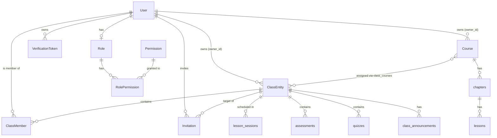
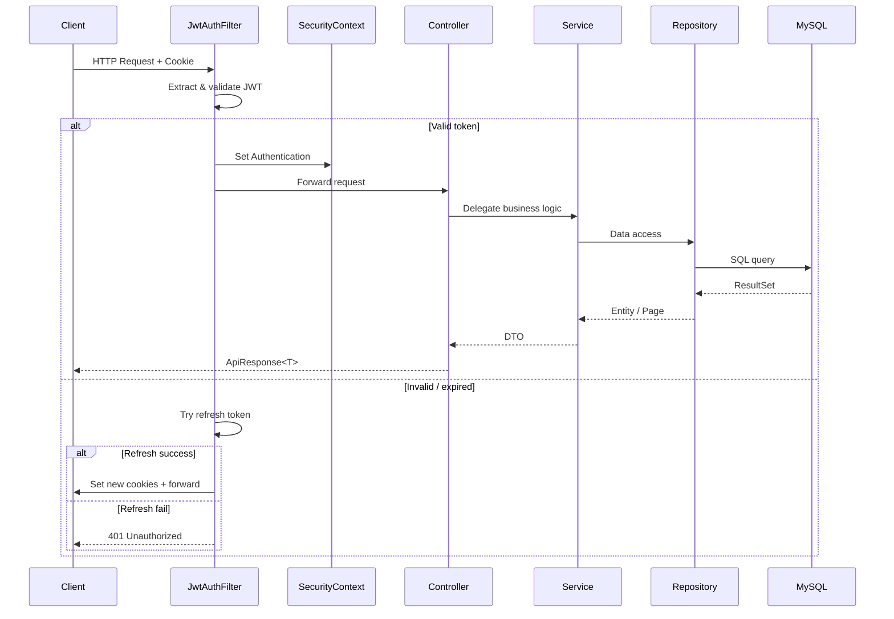
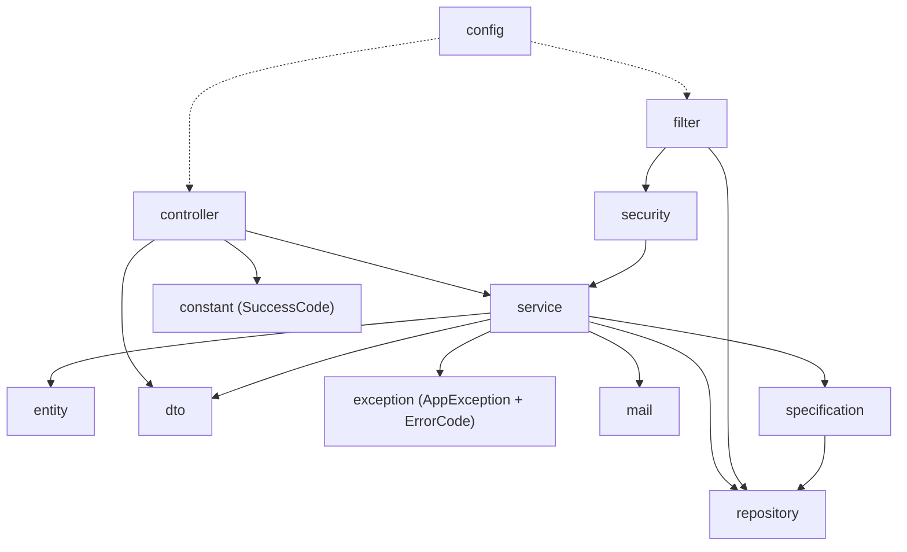

# ARCHITECTURE.md — ILMS Backend

> **Tài liệu tham chiếu kiến trúc kỹ thuật.** Cập nhật khi cấu trúc thay đổi.  
> Agent: đọc phần liên quan trước khi code; đừng đọc toàn bộ trừ khi task yêu cầu.

---

## 1. Tổng quan hệ thống

**ILMS (Intelligent Learning Management System)** — Hệ thống quản lý học tập thông minh tích hợp AI.

| Thuộc tính | Giá trị |
|---|---|
| Loại ứng dụng | Monolithic REST API (Backend) |
| Framework | Spring Boot 3.3.4 (Java 21) |
| Kiến trúc | Layered Architecture (Controller → Service → Repository) |
| Cơ sở dữ liệu | MySQL 8.0+ (utf8mb4) |
| Database Migration | Flyway |
| Xác thực | JWT (access + refresh token qua HttpOnly Cookie) |
| Phân quyền | RBAC (Role-Based Access Control) với Spring Security |
| Build tool | Gradle (Groovy DSL) |
| API docs | SpringDoc OpenAPI / Swagger UI |
| Message broker | Apache Kafka (dependency đã khai báo) |

### Các thành phần tích hợp dự kiến
- **AI Engine**: Chatbot trợ lý học tập, phân tích knowledge heatmap, gợi ý lộ trình, sinh đề thi
- **Email Service**: JavaMailSender (SMTP Gmail) — gửi mail xác thực, reset password, thông báo
- **Kafka**: Event-driven messaging (đã có dependency, chưa triển khai producer/consumer)

---

## 2. Cấu trúc thư mục dự án

```
ilms/
├── build.gradle                    # Dependencies & build config
├── settings.gradle                 # Root project name: 'ilms'
├── gradlew / gradlew.bat          # Gradle wrapper
│
├── src/main/java/com/example/ilms/
│   ├── IlmsApplication.java       # Entry point (@SpringBootApplication + @EnableJpaAuditing)
│   │
│   ├── config/                    # § 3. Configuration
│   │   ├── AsyncConfig.java
│   │   ├── CloudinaryConfig.java
│   │   ├── ModelMapperConfig.java
│   │   ├── OpenApiConfig.java
│   │   └── SecurityConfig.java
│   │
│   ├── constant/                  # § 4. Constants & Success codes
│   │   └── SuccessCode.java
│   │
│   ├── controller/                # § 5. Presentation Layer
│   │   ├── AiChatMessageController.java
│   │   ├── AiChatSessionController.java
│   │   ├── AuthController.java
│   │   ├── ClassController.java
│   │   ├── ClassMemberController.java
│   │   ├── CourseController.java
│   │   ├── OAuthController.java
│   │   ├── PermissionController.java
│   │   ├── RoleController.java
│   │   ├── UploadController.java
│   │   └── UserController.java
│   │
│   ├── dto/                       # § 6. Data Transfer Objects
│   │   ├── aichat/                # AI Chat request/response DTOs
│   │   ├── auth/                  # Auth & OAuth DTOs (AuthResult, OAuthCodeRequestDTO, ...)
│   │   ├── classDTO/              # Class request/response DTOs
│   │   ├── common/                # PageResponse<T>
│   │   ├── course/                # Course request/response DTOs
│   │   ├── permission/            # Permission request/response DTOs
│   │   ├── response/              # ApiResponse<T>, ErrorResponse
│   │   ├── role/                  # Role request/response DTOs
│   │   ├── upload/                # FileUploadResponseDTO
│   │   └── user/                  # User request/response DTOs
│   │
│   ├── entity/                    # § 7. Domain Model (JPA Entities)
│   │   ├── AiChatMessage.java
│   │   ├── AiChatSession.java
│   │   ├── ClassEntity.java
│   │   ├── ClassMember.java
│   │   ├── Course.java
│   │   ├── Invitation.java
│   │   ├── Permission.java
│   │   ├── Role.java
│   │   ├── RolePermission.java
│   │   ├── RolePermissionId.java
│   │   ├── User.java
│   │   └── VerificationToken.java
│   │
│   ├── exception/                 # § 8. Exception Handling
│   │   ├── AppException.java
│   │   ├── DuplicateResourceException.java
│   │   ├── ErrorCode.java
│   │   ├── GlobalExceptionHandler.java
│   │   └── ResourceNotFoundException.java
│   │
│   ├── filter/                    # § 9. Servlet Filters
│   │   └── JwtAuthenticationFilter.java
│   │
│   ├── mail/                      # § 10. Email Service
│   │   ├── dto/
│   │   └── template/
│   │
│   ├── repository/                # § 11. Data Access Layer
│   │   ├── AiChatMessageRepository.java
│   │   ├── AiChatSessionRepository.java
│   │   ├── ClassMemberRepository.java
│   │   ├── ClassRepository.java
│   │   ├── CourseRepository.java
│   │   ├── InvitationRepository.java
│   │   ├── PermissionRepository.java
│   │   ├── RolePermissionRepository.java
│   │   ├── RoleRepository.java
│   │   ├── UserRepository.java
│   │   └── VerificationTokenRepository.java
│   │
│   ├── security/                  # § 12. Security Components
│   │   ├── oauth/
│   │   │   ├── GithubOAuthService.java
│   │   │   └── GoogleOAuthService.java
│   │   ├── CustomUserDetailsService.java
│   │   └── TokenProvider.java
│   │
│   ├── service/                   # § 13. Business Logic Layer
│   │   ├── AiChatMessageService.java
│   │   ├── AiChatSessionService.java
│   │   ├── AuthService.java
│   │   ├── ClassMemberService.java
│   │   ├── ClassService.java
│   │   ├── CourseService.java
│   │   ├── EmailService.java
│   │   ├── InvitationService.java
│   │   ├── JwtService.java
│   │   ├── OAuthService.java
│   │   ├── PermissionService.java
│   │   ├── RoleService.java
│   │   ├── UploadService.java
│   │   └── UserService.java
│   │
│   ├── specification/             # § 14. JPA Specifications (Dynamic query)
│   │   ├── AiChatSessionSpecification.java
│   │   ├── ClassSpecification.java
│   │   ├── PermissionSpecification.java
│   │   └── RoleSpecification.java
│   │
│   ├── type/                      # § 15. Enumerations
│   │   ├── InvitationStatus.java
│   │   ├── TokenStatus.java
│   │   ├── TokenType.java
│   │   ├── UserStatus.java
│   │   └── Visibility.java
│   │
│   └── util/                      # § 16. Utilities
│       └── CookieUtils.java
│
├── src/main/resources/
│   ├── application.properties     # Cấu hình chính
│   ├── db/migration/              # 37 Flyway migration scripts
│   ├── static/                    # Tài nguyên tĩnh
│   └── templates/                 # Email templates
│
├── src/test/                      # Unit & integration tests
│
├── docs/                          # Tài liệu dự án
│   ├── PRD.md
│   ├── api-spec.md
│   ├── design-system.md
│   ├── glossary.md
│   └── decisions/
│
├── reports/                       # Task reports
├── AGENTS.md                      # Agent entry point
├── TASKS.md                       # Task tracking
└── README.md                      # Project overview
```

---

## 3. Layered Architecture

Dự án tuân theo kiến trúc phân tầng (Layered Architecture) chuẩn Spring Boot:

```
┌─────────────────────────────────────────────────────────────┐
│                   CLIENT (Web / Mobile)                     │
└────────────────────────┬────────────────────────────────────┘
                         │ HTTP Request / Response
                         ▼
┌─────────────────────────────────────────────────────────────┐
│  FILTER LAYER       JwtAuthenticationFilter                 │
│                     (Xác thực JWT Cookie trước mọi request) │
└────────────────────────┬────────────────────────────────────┘
                         ▼
┌─────────────────────────────────────────────────────────────┐
│  CONTROLLER LAYER   @RestController                         │
│                     Tiếp nhận request, validate, trả        │
│                     ApiResponse<T>                          │
└────────────────────────┬────────────────────────────────────┘
                         ▼
┌─────────────────────────────────────────────────────────────┐
│  SERVICE LAYER      @Service                                │
│                     Business logic, transaction management, │
│                     DTO ↔ Entity mapping (ModelMapper)       │
└────────────────────────┬────────────────────────────────────┘
                         ▼
┌─────────────────────────────────────────────────────────────┐
│  REPOSITORY LAYER   Spring Data JPA (JpaRepository)         │
│                     + JPA Specification (dynamic queries)   │
└────────────────────────┬────────────────────────────────────┘
                         ▼
┌─────────────────────────────────────────────────────────────┐
│  DATABASE           MySQL 8.0+ (Flyway migration)           │
└─────────────────────────────────────────────────────────────┘
```

### Quy tắc luồng dữ liệu

| Từ | Đến | Cho phép? |
|---|---|---|
| Controller | Service | ✅ |
| Service | Repository | ✅ |
| Service | Service (cùng tầng) | ✅ (cẩn thận circular) |
| Controller | Repository | ❌ (phải qua Service) |
| Repository | Service | ❌ |
| Filter | Service | ✅ (chỉ cho auth) |

---

## 4. Domain Model (Entity Relationship)

### 4.1. Entity chính hiện có (code)

| Entity | Table | ID Type | Mô tả |
|---|---|---|---|
| `User` | `users` | `UUID (BINARY 16)` | Tài khoản người dùng, implements `UserDetails` |
| `Role` | `roles` | `UUID` | Vai trò hệ thống (ROLE_ADMIN, ROLE_USER, ...) |
| `Permission` | `permissions` | `UUID` | Quyền hạn chi tiết theo module |
| `RolePermission` | `role_permissions` | Composite | Bảng liên kết N-N giữa Role ↔ Permission |
| `ClassEntity` | `classes` | `UUID (BINARY 16)` | Lớp học (classroom / cohort) |
| `ClassMember` | `class_members` | `UUID (BINARY 16)` | Thành viên trong lớp (role: OWNER/TEACHER/STUDENT) |
| `Course` | `courses` | `UUID` | Môn học / Khóa học |
| `Invitation` | `invitations` | `UUID (BINARY 16)` | Lời mời tham gia lớp qua email |
| `VerificationToken` | `verification_tokens` | `UUID` | Token xác thực (reset password, email verify) |
| `AiChatSession` | `ai_chat_sessions` | `UUID (BINARY 16)` | Phiên chat AI học tập |
| `AiChatMessage` | `ai_chat_messages` | `UUID (BINARY 16)` | Tin nhắn trong phiên chat AI |

### 4.2. Bảng đã có migration nhưng chưa có Entity class

> Cơ sở dữ liệu đã có schema đầy đủ qua Flyway. Các bảng dưới đây chưa có Entity/Repository/Service tương ứng trong code Java — đang chờ triển khai.

| Table | Migration | Mô tả |
|---|---|---|
| `class_courses` | V20260922163610 | Liên kết N-N: Class ↔ Course |
| `rooms` | V20260922164000 | Phòng học vật lý |
| `time_slots` | V20260922164001 | Tiết học (slot thời gian) |
| `lesson_sessions` | V20260922164057 | Buổi học cụ thể (room + slot + date) |
| `attendances` | V20260922164534 | Điểm danh |
| `grade_reports` | V20260922164856 | Báo cáo điểm |
| `chapters` | V20260922165105 | Chương trong khóa học |
| `lessons` | V20260922165117 | Bài học trong chương |
| `class_announcements` | V20260922170749 | Thông báo lớp học |
| `assessments` | V20260922170800 | Đánh giá (assessment container) |
| `assignments` | V20260922170900 | Bài tập |
| `exams` | V20260922170921 | Bài thi |
| `materials` | V20260922170940 | Tài liệu học |
| `material_versions` | V20260922170941 | Immutable source/parse revisions |
| `ingestion_jobs` | V20260922170942 | Ingestion source policy, checkpoints and leases |
| `knowledge_graph_drafts` | V20260922170943 | Graph revisions and teacher review |
| `material_publications` | V20260922170944 | Exact reviewed revision and current publication pointer |
| `submissions` | V20260922171142 | Bài nộp của học viên |
| `gradings` | V20260922171208 | Chấm điểm |
| `questions` | V20260922171209 | Ngân hàng câu hỏi |
| `quizzes` | V20260922171610 | Bài trắc nghiệm |
| `quiz_questions` | V20260922171629 | Câu hỏi trong bài trắc nghiệm |
| `quiz_options` | V20260922171648 | Lựa chọn cho câu hỏi quiz |
| `quiz_answers` | V20260922171748 | Câu trả lời của học viên |
| `exam_questions` | V20260922172022 | Câu hỏi trong bài thi |
| `question_concepts` | V20260922175727 | Khái niệm liên kết với câu hỏi |
| `material_chunks` | V20260922175725 | Version-bound source chunks; UNIQUE(version, index) |
| `student_knowledge_heatmaps` | V20260923221745 | Bản đồ kiến thức học viên |
| `ai_study_recommendations` | V20260923221831 | Gợi ý học tập từ AI |
| `student_error_patterns` | V20260923221857 | Mẫu lỗi thường gặp của học viên |

### 4.3. ER Diagram (simplified)



---

## 5. Authentication & Security

### 5.1. Luồng xác thực

```
Client                          Backend
  │                                │
  ├─ POST /api/v1/auth/login ────►│
  │  { email, password }          │
  │                                │ AuthenticationManager.authenticate()
  │                                │ → DaoAuthenticationProvider
  │                                │ → CustomUserDetailsService.loadByUsername()
  │                                │ → BCryptPasswordEncoder.matches()
  │                                │
  │◄── Set-Cookie: access-token ──│ TokenProvider.generateAccessToken()
  │◄── Set-Cookie: refresh-token ─│ TokenProvider.generateRefreshToken()
  │◄── Body: ApiResponse<User> ───│
  │                                │
  ├─ GET /api/v1/classes ─────────►│
  │  Cookie: access-token=xxx      │
  │                                │ JwtAuthenticationFilter
  │                                │ → extractId(accessToken)
  │                                │ → validateToken()
  │                                │ → setAuthentication(user)
  │                                │
  │◄── ApiResponse<data> ─────────│
```

### 5.2. Token Strategy

| Token | Lưu trữ | Thời hạn | Mục đích |
|---|---|---|---|
| Access Token | HttpOnly Cookie (`access-token`) | 24h (86400000ms) | Xác thực mọi request |
| Refresh Token | HttpOnly Cookie (`refresh-token`) | 7 ngày (604800000ms) | Làm mới access token khi hết hạn |

- JWT subject = `user.id` (UUID string)
- JWT claims chứa: `email`, `role`
- Khi access token hết hạn, `JwtAuthenticationFilter` tự động dùng refresh token để tạo cặp token mới và set lại cookie

### 5.3. Cấu hình Security

- **CSRF**: Disabled (stateless JWT)
- **Session**: `STATELESS`
- **CORS**: Chỉ cho phép `http://localhost:3000` (frontend)
- **Method Security**: `@EnableMethodSecurity` — hỗ trợ `@PreAuthorize`
- **Password Encoder**: `BCryptPasswordEncoder`

### 5.4. Public endpoints (không yêu cầu auth)

```
/api/v1/auth/register
/api/v1/auth/login
/api/v1/auth/send-email-forgot-password
/api/v1/auth/forgot-password
/api/v1/auth/verify-reset-token
/v3/api-docs/**
/swagger-ui/**
/swagger-ui.html
```

---

## 6. API Response Standards

### 6.1. Success Response — `ApiResponse<T>`

Mọi API phải trả về qua wrapper `ApiResponse<T>`. **Không bao giờ trả raw entity.**

```java
// Controller
return ApiResponse.of(SuccessCode.GET_USER_SUCCESS, userDto);
```

```json
{
  "status": 200,
  "message": "Lấy thông tin người dùng thành công",
  "data": { ... },
  "timestamp": "2026-10-14T10:00:00.000"
}
```

### 6.2. Paginated Response — `PageResponse<T>`

```json
{
  "status": 200,
  "message": "...",
  "data": {
    "items": [ ... ],
    "pageNumber": 1,
    "pageSize": 10,
    "totalElements": 42,
    "totalPages": 5,
    "isLast": false
  },
  "timestamp": "..."
}
```

### 6.3. Error Response — `ErrorResponse`

```json
{
  "status": 404,
  "message": "Không tìm thấy người dùng",
  "timestamp": "...",
  "errors": null
}
```

Validation errors bổ sung field `errors` (map field → message):

```json
{
  "status": 400,
  "message": "Dữ liệu gửi lên không hợp lệ",
  "errors": {
    "email": "Email không hợp lệ",
    "password": "Mật khẩu phải có ít nhất 6 ký tự"
  },
  "timestamp": "..."
}
```

### 6.4. Success Codes (`SuccessCode` enum)

Mọi thông báo thành công phải khai báo trong `SuccessCode` trước khi sử dụng. Không hardcode string.

| Module | Ví dụ |
|---|---|
| Auth | `REGISTER_SUCCESS`, `LOGIN_SUCCESS`, `LOGOUT_SUCCESS`, `REFRESH_TOKEN_SUCCESS`, `CHANGED_PASSWORD_SUCCESS` |
| User | `GET_USER_SUCCESS`, `UPDATE_PROFILE_SUCCESS`, `CREATE_USER_SUCCESS` |
| Class | `CLASS_CREATED`, `ENROLL_CLASS_SUCCESS`, `GET_CLASSES_SUCCESS`, `APPROVE_CLASS_MEMBER_SUCCESS` |
| Course | `GET_COURSES_SUCCESS`, `CREATE_COURSE_SUCCESS`, `UPDATE_COURSE_SUCCESS`, `DELETE_COURSE_SUCCESS` |

### 6.5. Error Codes (`ErrorCode` enum)

Mọi lỗi nghiệp vụ khai báo trong `ErrorCode`, mỗi entry chứa `HttpStatus` + `message`.

| Nhóm | Ví dụ |
|---|---|
| Auth | `USER_EXISTED`, `EMAIL_EXISTED`, `INVALID_CREDENTIALS`, `INVALID_TOKEN`, `USER_DISABLED` |
| Class | `CLASS_NOT_FOUND`, `ALREADY_CLASS_MEMBER`, `CLASS_ACCESS_DENIED`, `CLASS_OWNER_CANNOT_BE_REMOVED` |
| Invitation | `INVITATION_NOT_FOUND`, `INVITATION_EXPIRED`, `INVITATION_EMAIL_MISMATCH` |
| Course | `COURSE_NOT_FOUND` |

---

## 7. Exception Handling

### `GlobalExceptionHandler` (`@RestControllerAdvice`)

| Exception | Xử lý |
|---|---|
| `MethodArgumentNotValidException` | Trả `400` + map field errors |
| `AppException` | Trả HTTP status & message từ `ErrorCode` |
| `DataIntegrityViolationException` | Trả `409 CONFLICT` |
| `DuplicateResourceException` | Trả `409 CONFLICT` |

### Quy tắc ném lỗi

```java
// ĐÚNG — Ném AppException với ErrorCode
User user = userRepository.findById(id)
    .orElseThrow(() -> new AppException(ErrorCode.USER_NOT_FOUND));

// SAI — Không try-catch rồi trả ResponseEntity thủ công trong Controller
```

---

## 8. DTO & Mapping Conventions

### 8.1. Tổ chức DTO

```
dto/
├── auth/
│   ├── LoginRequestDTO.java
│   ├── RegisterRequestDTO.java
│   ├── ForgotPasswordRequestDTO.java
│   ├── ResetPasswordRequestDTO.java
│   ├── ChangePasswordRequestDTO.java
│   └── AuthResult.java              ← Internal: chứa user + cookie pair
├── classDTO/
│   ├── ClassCreateRequestDTO.java
│   ├── ClassResponseDTO.java
│   ├── ClassMemberResponseDTO.java
│   ├── JoinByCodeRequestDTO.java
│   ├── InviteByEmailRequestDTO.java
│   ├── ApproveClassMemberRequestDTO.java
│   ├── ChangeClassMemberRoleRequestDTO.java
│   └── AcceptInvitationRequestDTO.java
├── course/
│   ├── CourseCreateRequestDTO.java
│   └── CourseResponseDTO.java
├── user/
│   ├── UserCreateRequestDTO.java
│   ├── UserResponseDTO.java
│   ├── UserUpdateRequestDTO.java
│   └── UserUpdateRoleRequest.java
├── common/
│   └── PageResponse.java
└── response/
    ├── ApiResponse.java
    └── ErrorResponse.java
```

### 8.2. Naming

- Request DTO: `XxxRequestDTO`
- Response DTO: `XxxResponseDTO`
- Dùng `@Valid` trên Controller để validate request DTO
- Mapping Entity ↔ DTO qua `ModelMapper` (bean trong `ModelMapperConfig`)

### 8.3. Mapping Pattern

```java
// Entity → DTO (trong Service)
UserResponseDTO dto = modelMapper.map(user, UserResponseDTO.class);

// DTO → Entity (trong Service)
User user = modelMapper.map(requestDto, User.class);
user.setPassword(passwordEncoder.encode(requestDto.getPassword()));
```

---

## 9. Roles & Permissions (RBAC)

### 9.1. Cấu trúc phân quyền

```
Role (roles)
  └─── N:N ───► Permission (permissions)
                via role_permissions
User
  └─── N:1 ───► Role
```

### 9.2. Roles hiện tại

| Role Code | Mô tả |
|---|---|
| `ROLE_ADMIN` | Quản trị viên toàn hệ thống |
| `ROLE_USER` | Người dùng mặc định khi đăng ký |

### 9.3. Class-level Roles (trong `class_members.role`)

| Role | Mô tả |
|---|---|
| `OWNER` | Chủ sở hữu lớp (tạo lớp) |
| `TEACHER` | Giảng viên trong lớp |
| `STUDENT` | Học viên trong lớp |

### 9.4. Phân quyền trong code

```java
// Method-level security
@PreAuthorize("hasRole('ADMIN')")
public ApiResponse<CourseResponseDTO> createCourse(...) { ... }

// Kiểm tra quyền trong Service (class-level)
if (!member.getRole().equals("OWNER") && !member.getRole().equals("TEACHER")) {
    throw new AppException(ErrorCode.CLASS_ACCESS_DENIED);
}
```

---

## 10. Key Business Modules

### 10.1. Auth Module

| Endpoint | Method | Mô tả |
|---|---|---|
| `/api/v1/auth/register` | POST | Đăng ký tài khoản (role mặc định: ROLE_USER) |
| `/api/v1/auth/login` | POST | Đăng nhập, trả JWT cookies |
| `/api/v1/auth/logout` | POST | Xóa cookies |
| `/api/v1/auth/me` | GET | Lấy thông tin user đang đăng nhập |
| `/api/v1/auth/forgot-password` | POST | Gửi email reset password |
| `/api/v1/auth/verify-reset-token` | GET | Kiểm tra token reset có hợp lệ |
| `/api/v1/auth/reset-password` | POST | Đặt lại mật khẩu |
| `/api/v1/auth/change-password` | POST | Đổi mật khẩu (cần auth) |

**Flow**: `Controller → AuthService → UserRepository/TokenProvider/EmailService`

### 10.2. Class Module

| Endpoint | Method | Mô tả |
|---|---|---|
| `/api/v1/classes` | POST | Tạo lớp học mới |
| `/api/v1/classes` | GET | Danh sách lớp (phân trang, tìm kiếm, lọc) |

Quản lý thành viên lớp qua `ClassMemberController`:
- Tham gia bằng mã lớp, mời qua email
- Duyệt thành viên, đổi vai trò, xóa thành viên
- Rời lớp, chấp nhận lời mời

**Flow**: `Controller → ClassService/ClassMemberService/InvitationService → ClassRepository/ClassMemberRepository/InvitationRepository`

### 10.3. Course Module

| Endpoint | Method | Mô tả |
|---|---|---|
| `/api/v1/courses` | POST | Tạo môn học (chỉ ADMIN) |
| `/api/v1/courses` | GET | Danh sách môn học (phân trang) |

**Flow**: `Controller → CourseService → CourseRepository`

### 10.4. User Module

Quản lý hồ sơ, tạo user, cập nhật role.

---

## 11. Database & Migration

### 11.1. Flyway Configuration

```properties
spring.flyway.enabled=true
spring.jpa.hibernate.ddl-auto=none     # Flyway quản lý schema, không dùng Hibernate ddl
spring.flyway.repair=true
spring.flyway.validate-on-migrate=false
spring.flyway.out-of-order=true
```

### 11.2. Tạo migration mới

```bash
./gradlew createMigration -Pname=create_xxx_table
# → Tạo file: src/main/resources/db/migration/V{timestamp}__create_xxx_table.sql
```

### 11.3. Naming convention

```
V{yyyyMMddHHmmss}__{description}.sql
```

### 11.4. Quy tắc

- **Không bao giờ** sửa file migration đã chạy trên production
- Mọi thay đổi schema mới → tạo migration mới
- Dùng `BINARY(16)` cho UUID columns
- Soft delete: dùng column `deleted_at TIMESTAMP NULL`
- Audit: `created_at`, `updated_at` tự động qua `@CreatedDate`/`@LastModifiedDate`

---

## 12. Coding Conventions

### 12.1. Entity

```java
@Entity
@Table(name = "xxx")
@Getter @Setter @NoArgsConstructor @AllArgsConstructor @Builder
@EntityListeners(AuditingEntityListener.class)
public class Xxx {
    @Id
    @GeneratedValue(strategy = GenerationType.UUID)
    @JdbcTypeCode(SqlTypes.BINARY)
    @Column(name = "id", columnDefinition = "BINARY(16)", updatable = false, nullable = false)
    private UUID id;

    @CreatedDate
    @Column(name = "created_at", nullable = false, updatable = false)
    private LocalDateTime createdAt;

    @LastModifiedDate
    @Column(name = "updated_at", nullable = false)
    private LocalDateTime updatedAt;

    @Column(name = "deleted_at")
    private LocalDateTime deletedAt;         // Soft delete
}
```

### 12.2. Controller

```java
@RestController
@RequestMapping("/api/v1/xxx")
@RequiredArgsConstructor
public class XxxController {
    private final XxxService xxxService;

    @GetMapping("/{id}")
    public ApiResponse<XxxResponseDTO> getById(@PathVariable UUID id) {
        XxxResponseDTO result = xxxService.getById(id);
        return ApiResponse.of(SuccessCode.GET_XXX_SUCCESS, result);
    }
}
```

### 12.3. Service

```java
@Service
@RequiredArgsConstructor
public class XxxService {
    private final XxxRepository xxxRepository;
    private final ModelMapper modelMapper;

    public XxxResponseDTO getById(UUID id) {
        Xxx entity = xxxRepository.findById(id)
            .orElseThrow(() -> new AppException(ErrorCode.XXX_NOT_FOUND));
        return modelMapper.map(entity, XxxResponseDTO.class);
    }
}
```

### 12.4. Repository

```java
public interface XxxRepository extends JpaRepository<Xxx, UUID> {
    // Custom query methods
    Optional<Xxx> findByCode(String code);
    boolean existsByEmail(String email);
}
```

---

## 13. Quy tắc phát triển module mới

Khi thêm module mới (ví dụ: `Lesson`, `Quiz`, `Attendance`...), tuân theo checklist:

1. **Migration**: Tạo file migration nếu chưa có (đã có 37 migration sẵn cho hầu hết bảng)
2. **Entity**: Tạo `entity/Xxx.java` với `@Entity`, UUID id, audit fields
3. **Repository**: Tạo `repository/XxxRepository.java extends JpaRepository<Xxx, UUID>`
4. **DTO**: Tạo `dto/xxx/XxxCreateRequestDTO.java`, `XxxResponseDTO.java` (với `@Valid` annotations)
5. **Service**: Tạo `service/XxxService.java` — business logic, mapping, validation
6. **Controller**: Tạo `controller/XxxController.java` — thin layer, chỉ delegate to service
7. **SuccessCode**: Thêm entries vào `constant/SuccessCode.java`
8. **ErrorCode**: Thêm entries vào `exception/ErrorCode.java` nếu cần
9. **Specification** (optional): Tạo `specification/XxxSpecification.java` nếu cần dynamic query

---

## 14. Enumerations

### User Status (`type/UserStatus.java`)

| Value | Mô tả |
|---|---|
| `PENDING` | Chờ kích hoạt (mặc định khi đăng ký) |
| `ACTIVE` | Đang hoạt động |
| `LOCKED` | Bị khóa (không thể đăng nhập) |

### Token Status (`type/TokenStatus.java`)

| Value | Mô tả |
|---|---|
| `PENDING` | Chờ sử dụng |
| `VERIFIED` | Đã sử dụng |
| `EXPIRED` | Đã hết hạn |
| `REVOKED` | Đã thu hồi |

### Token Type (`type/TokenType.java`)

| Value | Mô tả |
|---|---|
| `RESET_PASSWORD` | Token đặt lại mật khẩu |
| `EMAIL_VERIFICATION` | Token xác thực email |
| `INVITATION` | Token mời tham gia |

### Invitation Status (`type/InvitationStatus.java`)

| Value | Mô tả |
|---|---|
| `PENDING` | Chờ phản hồi |
| `ACCEPTED` | Đã chấp nhận |
| `REJECTED` | Đã từ chối |

### Visibility (`type/Visibility.java`)

| Value | Mô tả |
|---|---|
| `PUBLIC` | Công khai |
| `PRIVATE` | Riêng tư |

---

## 15. Dependencies

### Runtime

| Library | Version | Mục đích |
|---|---|---|
| Spring Boot Starter Web | 3.3.4 | REST API framework |
| Spring Boot Starter Security | 3.3.4 | Authentication & authorization |
| Spring Boot Starter Data JPA | 3.3.4 | ORM / database access |
| Spring Boot Starter Validation | 3.3.4 | Bean validation (@Valid) |
| Spring Boot Starter Mail | 3.3.4 | Email sending |
| Spring Kafka | 3.3.4 | Message broker |
| MySQL Connector/J | managed | JDBC driver |
| Flyway Core + MySQL | managed | Database migration |
| JJWT (API + Impl + Jackson) | 0.11.5 | JWT token generation & validation |
| SpringDoc OpenAPI | 2.6.0 | Swagger UI / API docs |
| ModelMapper | 3.2.6 | Object mapping (Entity ↔ DTO) |
| Bucket4j Core | 8.10.1 | Rate limiting |
| TOTP (dev.samstevens) | 1.7.1 | TOTP 2FA support |
| Lombok | managed | Boilerplate reduction |

### Test

| Library | Mục đích |
|---|---|
| Spring Boot Starter Test | JUnit 5, Mockito, AssertJ |
| Spring Security Test | Security test utilities |
| Spring Kafka Test | Kafka integration testing |

---

## 16. Build & Run

### Prerequisites

- JDK 21+
- MySQL 8.0+
- (Optional) Kafka broker nếu dùng Kafka features

### Commands

```bash
# Chạy ứng dụng dev
./gradlew bootRun

# Build JAR
./gradlew build

# Chạy tests
./gradlew test

# Clean build artifacts
./gradlew clean

# Tạo migration mới
./gradlew createMigration -Pname=my_migration_name
```

### Swagger UI

Sau khi chạy app: [http://localhost:8080/swagger-ui.html](http://localhost:8080/swagger-ui.html)

---

## 17. Configuration

### `application.properties` — Các nhóm cấu hình

| Nhóm | Key prefix | Mô tả |
|---|---|---|
| Datasource | `spring.datasource.*` | Kết nối MySQL |
| JPA | `spring.jpa.*` | Hibernate settings (`ddl-auto=none`, `show-sql`) |
| Flyway | `spring.flyway.*` | Migration config |
| JWT | `jwt.*` | Secret key, token expiration |
| Mail | `spring.mail.*` | SMTP server config |
| Swagger | `springdoc.*` | API docs paths |

### Biến quan trọng

| Key | Giá trị mặc định | Mô tả |
|---|---|---|
| `spring.jpa.hibernate.ddl-auto` | `none` | Flyway quản lý schema |
| `spring.jpa.open-in-view` | `false` | Tắt OSIV để tránh lazy loading ngoài transaction |
| `jwt.access-token.expiration` | `86400000` (24h) | Thời hạn access token |
| `jwt.refresh-token.expiration` | `604800000` (7 ngày) | Thời hạn refresh token |

---

## 18. AI Integration (Planned)

Dự án đã chuẩn bị schema DB cho các tính năng AI:

| Bảng | Chức năng |
|---|---|
| `ai_chat_sessions` + `ai_chat_messages` | Chatbot trợ lý học tập theo phiên |
| `material_chunks` | Chia nhỏ tài liệu để phục vụ RAG (Retrieval-Augmented Generation) |
| `student_knowledge_heatmaps` | Bản đồ kiến thức — mức độ thành thạo từng khái niệm (0.000 → 1.000) |
| `ai_study_recommendations` | Gợi ý học tập cá nhân hóa từ AI |
| `student_error_patterns` | Phân tích lỗi thường gặp của học viên |
| `question_concepts` | Liên kết câu hỏi với khái niệm (knowledge graph) |

---

## 19. Soft Delete Pattern

Các entity quan trọng dùng soft delete qua `deleted_at`:

```java
@Column(name = "deleted_at")
private LocalDateTime deletedAt;
```

- `deletedAt = null` → active record
- `deletedAt != null` → đã xóa mềm
- Query mặc định nên filter `WHERE deleted_at IS NULL`

Áp dụng cho: `User`, `ClassEntity`, `Course`

---

## 20. Invitation System

Hệ thống mời thành viên vào lớp học:

```
Owner/Teacher tạo lời mời
  → InvitationService tạo Invitation (token UUID, expires 7 ngày)
  → EmailService gửi email chứa link invitation
  → Người được mời click link
  → Accept invitation → thêm ClassMember
```

| Field | Mô tả |
|---|---|
| `token` | UUID unique, dùng để xác thực lời mời |
| `role` | Vai trò được mời (TEACHER/STUDENT) |
| `status` | PENDING → ACCEPTED / REJECTED |
| `expiresAt` | Thời hạn lời mời |

---

## 21. JPA Specification (Dynamic Query)

Dự án dùng **JPA Specification** cho các query phức tạp (search, filter, sort):

```java
// ClassSpecification.java
public static Specification<ClassEntity> withFilters(
    String search, String status, UUID semesterId, Boolean isArchived
) {
    // Xây dựng Predicate động theo các tham số
}
```

Pattern: Controller truyền params → Service gọi `repository.findAll(spec, pageable)` → trả `PageResponse<T>`.

---

## 22. Diagrams

### Request Lifecycle



### Module Dependency

