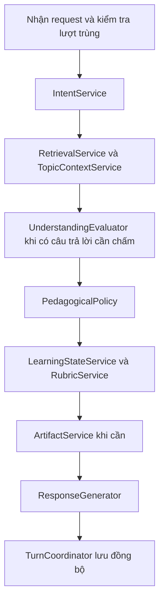

# Kiến trúc ILMS-AI

Cập nhật 2026-11-02. Dự án dùng duy nhất luồng Socratic cải tiến. Chưa kiểm chứng runtime sau hợp nhất.

## Đường gọi đang dùng

```text
app/main.py
  -> app/api/v1/endpoints/router.py
  -> app/api/v1/endpoints/chat_api.py
  -> app/api/deps.py
  -> app/controller/chat_controller.py
  -> app/service/tutoring/chat_service.py: SocraticChatService
```

Không có cờ chọn service hoặc facade chuyển phiên bản. Các route `/api/v1/...` giữ nguyên hợp đồng BE/FE. `protocol_version` chỉ chọn giao thức truyền SSE (1 buffer, 2 live); không chọn luồng nghiệp vụ. Request Python mặc định protocol 2.

## Điều phối Socratic



- `turn_coordinator.py`: transaction ngắn, lease, version, retry và replay; không khóa DB trong thời gian chờ LLM.
- `intent_service.py`: phân biệt câu hỏi, câu trả lời, xin trợ giúp, đổi chủ đề và phản biện.
- `retrieval_service.py`: context cache, Topic/chunk, graph và vector cùng phạm vi truy cập.
- `understanding_evaluator.py`: chấm theo câu hỏi/tiêu chí/nguồn đã lưu, bằng chứng từ câu trả lời.
- `pedagogical_policy.py`: quyết định sư phạm bằng Python; LLM không trực tiếp cập nhật tiến độ.
- `learning_state_service.py`: câu hỏi chờ, hỗ trợ tăng dần, ôn nền và quay lại mục tiêu.
- `progress_service.py`: tổng hợp bằng chứng; numeric mastery chưa được tự suy đoán.
- `response_generator.py`: prompt, live callback, hậu kiểm câu hỏi/trích dẫn.
- Prompt đang dùng tại `app/prompts/tutoring/{intent,evaluation,question,response}.md`.

## Lưu trữ

| Kho | Trách nhiệm |
|---|---|
| MySQL topics/topic_chunks/material_chunks | Topic do ingestion sinh và học liệu nguồn |
| MySQL session/message | Hội thoại, turn metadata và kết quả đã lưu |
| socratic_learning_state | Trạng thái học chính, pending, lease, return stack |
| socratic_turn_evaluations | Bằng chứng đánh giá theo tiêu chí |
| student_concept_progress | Tổng hợp theo người học/khái niệm |
| student_misconceptions | Ngộ nhận SUSPECTED/CONFIRMED/RESOLVED |
| Neo4j | Tri thức, quan hệ, ví dụ, bài tập và rubric được phép đọc |
| Chroma | Chỉ mục chunk/entity với embedding identity cố định |

Ingestion/quản trị tạo Topic, tri thức và duyệt rubric. Chat chỉ đọc và dạy học. Người dùng chưa vào lớp vẫn có thể gửi yêu cầu; không tự bỏ kiểm tra quyền nguồn hoặc FK user.

## SSE

Protocol 2 phát status tác vụ thật và token ngay khi provider sinh. Nội dung là nháp đến khi hậu kiểm/commit hoàn tất; content_replace đồng bộ phần đã phát, done chứa full_content cuối, lỗi có thể INCOMPLETE. Protocol 1 giữ dạng vận chuyển cũ cho client tương thích, dùng cùng service. Chi tiết ở [.docs/sse-contract.md](.docs/sse-contract.md).

## Vận hành và phạm vi

Ingestion production: FE /materials → Spring Boot upload và job → FastAPI /api/v1/internal/ingestion/draft → bốn agent → draft MySQL/Neo4j → publish Neo4j/Chroma → chat đọc publication hiện hành. Xem [.docs/material-ingestion-api.md](.docs/material-ingestion-api.md).

Settings chat dùng SOCRATIC_*, không còn cờ bật phiên bản. File .env được đổi tên key nhưng giữ giá trị/collection cũ; tên collection vật lý không được tự đổi hoặc xóa dữ liệu. Seed duy nhất cho tutoring: `python -m app.seed_tutoring --target chunks|entities`. Không tự chạy seed/migration.

Migration và báo cáo có ngày là lịch sử, giữ tên cũ để truy vết. Các module thử nghiệm/import src ngoài đường chat đang dùng chưa thuộc đợt dọn này. Windows từ chối xóa bốn prompt strategies cũ; không module hiện hành nào đọc chúng.

Hướng dẫn: [.docs/socratic-operator-guide.md](.docs/socratic-operator-guide.md), [.docs/socratic.env.example](.docs/socratic.env.example), [.docs/data-contracts.md](.docs/data-contracts.md).


## API quản trị đồ thị

BE /api/v1/knowledge-graphs dùng GraphAccessService để kiểm permission theo role hệ thống và vai trò lớp ACTIVE. MaterialIngestionService tái dùng cùng service phân quyền/chỉnh sửa/duyệt. AI /internal/knowledge-graphs xử lý DTO đọc và áp batch thao tác bằng Python, không gọi LLM. MySQL giữ snapshot bất biến và audit; Neo4j giữ projection theo revision và publication. Publisher so current publication + generation trước khi kích hoạt. Xem .docs/knowledge-graph-api-guide.md.

API nội bộ `concept-catalog` trả mã và nhãn khái niệm từ các bản xuất bản hiện hành mà Spring Boot đã chọn cho môn. Nó đối chiếu lại liên kết môn và hash đã duyệt trước khi trả danh mục. Spring Boot giữ quyền truy cập, câu hỏi, lượt làm, điểm và tổng hợp bản đồ nhiệt. [Hợp đồng API](.docs/knowledge-graph-api-guide.md#internal-concept-catalog-for-assessments)
